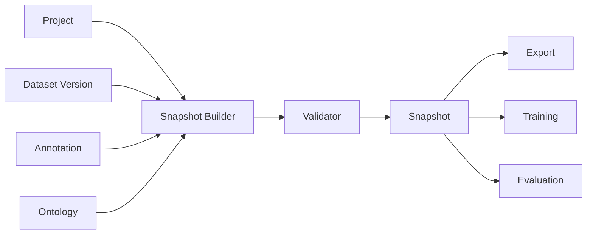
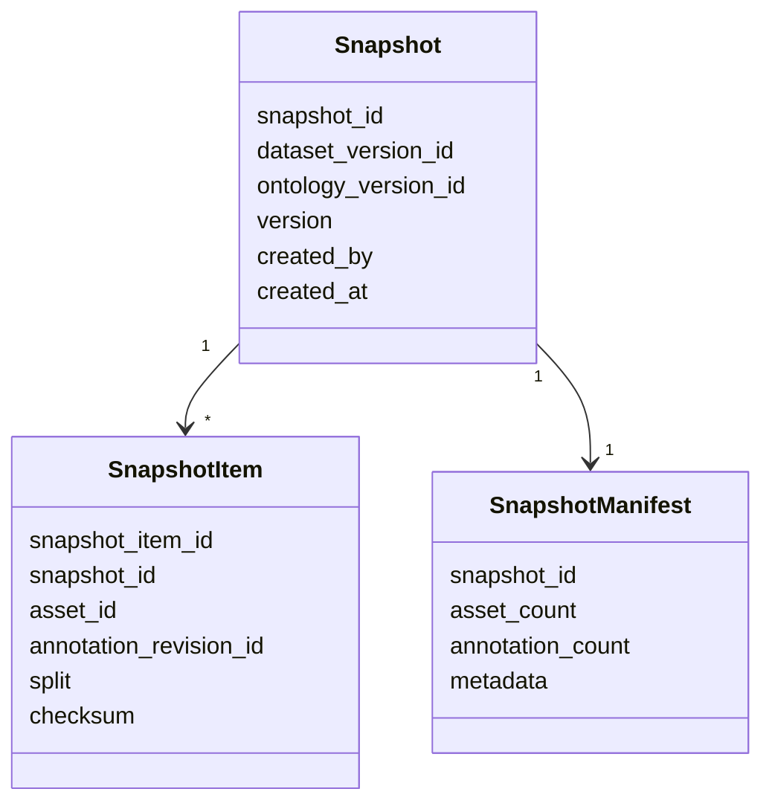
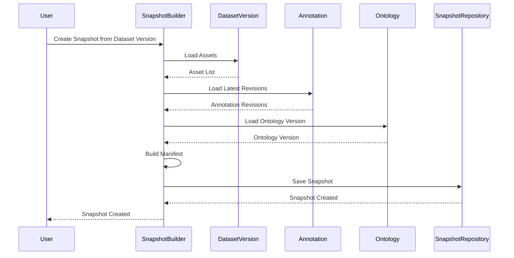
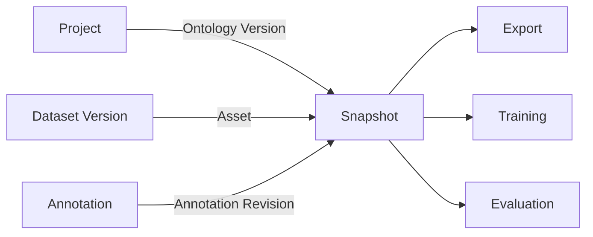

# Snapshot Domain

# Snapshot Domain Design

## 1. Mục tiêu (Objective)

`Snapshot Domain` chịu trách nhiệm quản lý các **phiên bản bất biến (Immutable Snapshot)** của dữ liệu trong AI Data Platform.

Snapshot đại diện cho một **phiên bản dữ liệu có thể tái lập (Reproducible Dataset State)** tại một thời điểm xác định. Mỗi Snapshot lưu tập hợp các tham chiếu (Reference) đến `Dataset Version`, `Asset`, `Annotation Revision` và `Ontology Version`, đảm bảo mọi tác vụ downstream luôn sử dụng cùng một trạng thái dữ liệu.

Snapshot Domain **không sở hữu Dataset, Asset hoặc Annotation**, mà chỉ quản lý các tham chiếu đến các Domain này.

### Phạm vi trách nhiệm

Snapshot Domain chịu trách nhiệm:

- Tạo Snapshot từ một `Dataset Version` xác định.
- Quản lý các phiên bản Snapshot.
- Đảm bảo Snapshot là Immutable.
- Quản lý Manifest mô tả Snapshot.
- Cung cấp Snapshot cho Export, Training và Evaluation.

### Không thuộc phạm vi

Snapshot Domain không chịu trách nhiệm:

- Quản lý Dataset gốc.
- Quản lý Asset vật lý.
- Quản lý Annotation đang hoạt động.
- Quản lý Workflow.
- Quản lý Training Job.
- Quản lý Model.

---

## 2. Thiết kế (Design)

Snapshot Domain được thiết kế theo nguyên tắc **Immutable Snapshot**.

Sau khi được tạo, Snapshot sẽ không bao giờ bị chỉnh sửa. Nếu `Dataset Version` hoặc `Annotation Revision` thay đổi, hệ thống sẽ tạo một Snapshot mới thay vì cập nhật Snapshot cũ.

Snapshot không sao chép dữ liệu mà chỉ lưu tham chiếu đến các Entity thuộc các Domain khác.

Thiết kế này giúp đảm bảo mọi tác vụ downstream luôn làm việc trên cùng một phiên bản dữ liệu đã được cố định.

---

## 3. Domain Model

Snapshot Domain được xây dựng xoay quanh các Entity sau.

| Entity | Trách nhiệm |
| --- | --- |
| `Snapshot` | Đại diện cho một phiên bản dữ liệu bất biến. |
| `Snapshot Item` | Liên kết Asset với Annotation Revision trong Snapshot. |
| `Snapshot Manifest` | Mô tả metadata và thống kê của Snapshot. |

---

### Snapshot

`Snapshot` là Aggregate Root của Domain.

Một Snapshot đại diện cho trạng thái dữ liệu tại một thời điểm xác định và luôn gắn với một `Dataset Version` cụ thể.

Snapshot không lưu dữ liệu Asset hoặc Annotation mà chỉ lưu tham chiếu đến các phiên bản dữ liệu tương ứng.

Mỗi Snapshot bao gồm:

- `Dataset Version`
- `Ontology Version`
- Danh sách `Snapshot Item`
- Metadata của Snapshot

Ví dụ:

| Thành phần | Mô tả |
| --- | --- |
| Snapshot Version | Phiên bản Snapshot |
| Dataset Version ID | Phiên bản Dataset nguồn |
| Ontology Version | Phiên bản Ontology |
| Asset Count | Tổng số Asset |
| Annotation Count | Tổng số Annotation |
| Created By | Người tạo |
| Created At | Thời gian tạo |

---

### Snapshot Item

`Snapshot Item` đại diện cho một đơn vị dữ liệu trong Snapshot.

Mỗi Item liên kết:

- Một Asset
- Một Annotation Revision
- Một Dataset Split
- Checksum phục vụ kiểm tra toàn vẹn dữ liệu

Ví dụ:

| Asset | Annotation Revision | Split |
| --- | --- | --- |
| image001.jpg | Revision #5 | Train |
| image002.jpg | Revision #2 | Validation |
| image003.jpg | Revision #8 | Test |

Snapshot Item không sở hữu dữ liệu mà chỉ lưu các khóa tham chiếu.

---

### Snapshot Manifest

`Snapshot Manifest` mô tả cấu trúc và thống kê của Snapshot.

Manifest thường được dùng để:

- Audit
- Export
- Training
- Traceability
- So sánh Snapshot

Ví dụ các thông tin trong Manifest:

- Dataset Version ID
- Ontology Version
- Tổng số Asset
- Tổng số Annotation
- Danh sách split
- Thông tin kiểm tra toàn vẹn
- Metadata bổ sung

---

## 4. Internal Snapshot Schema

Snapshot chỉ lưu tham chiếu đến dữ liệu, không sao chép Asset hoặc Annotation.

---

## 5. Business Rules

- Một Snapshot chỉ thuộc một `Dataset Version`.
- Một Snapshot là Immutable sau khi được tạo.
- Một Asset chỉ xuất hiện một lần trong cùng một Snapshot.
- Mỗi Snapshot Item phải tham chiếu đến một Annotation Revision hợp lệ.
- Snapshot chỉ tham chiếu đến các Revision đã tồn tại.
- Snapshot chỉ được tạo từ một Dataset Version đã được xác định rõ.
- Snapshot không được cập nhật trực tiếp sau khi phát hành.
- Export, Training và Evaluation chỉ được phép đọc dữ liệu từ Snapshot.

---

## 6. Domain Service

| Service | Vai trò |
| --- | --- |
| Snapshot Builder | Thu thập dữ liệu từ các Domain để tạo Snapshot. |
| Snapshot Validator | Kiểm tra tính hợp lệ của Snapshot trước khi lưu. |
| Snapshot Diff Service | So sánh sự khác biệt giữa hai Snapshot. |

---

## 7. Infrastructure

| Thành phần | Trách nhiệm |
| --- | --- |
| Snapshot Repository | Lưu trữ Snapshot, Snapshot Item và Snapshot Manifest. |
| Storage Adapter | Ghi Manifest vào MinIO hoặc Object Storage. |

---

## Snapshot Repository

Snapshot Repository chịu trách nhiệm lưu và truy xuất Snapshot.

Repository chỉ lưu:

- Snapshot
- Snapshot Item
- Snapshot Manifest

Repository không lưu:

- Dataset
- Dataset Version
- Asset
- Annotation

---

## Storage Adapter

Storage Adapter chịu trách nhiệm lưu Snapshot Manifest vào Object Storage để phục vụ Export, Training và Audit.

---

## 8. Workflow

## Tạo Snapshot

Snapshot chỉ được tạo khi toàn bộ dữ liệu cần thiết đã được thu thập thành công.

---

## 9. Database Design

### snapshots

| Cột | Mô tả |
| --- | --- |
| id | Snapshot ID |
| dataset_version_id | Dataset Version |
| ontology_version_id | Phiên bản Ontology |
| version | Phiên bản Snapshot |
| created_by | Người tạo |
| created_at | Thời gian tạo |

### snapshot_items

| Cột | Mô tả |
| --- | --- |
| id | Snapshot Item ID |
| snapshot_id | Snapshot |
| asset_id | Asset |
| annotation_revision_id | Annotation Revision |
| split | Train / Validation / Test |
| checksum | Integrity Checksum |

### snapshot_manifest

| Cột | Mô tả |
| --- | --- |
| snapshot_id | Snapshot |
| asset_count | Tổng số Asset |
| annotation_count | Tổng số Annotation |
| metadata | JSONB |

---

## 10. Quan hệ với các Domain khác

| Domain | Quan hệ với Snapshot Domain |
| --- | --- |
| **Project** | Cung cấp Ontology Version được sử dụng khi tạo Snapshot. |
| **Dataset Version** | Cung cấp danh sách Asset thuộc phiên bản dữ liệu đã được chốt. |
| **Annotation** | Cung cấp Annotation Revision của từng Asset. |
| **Export** | Sử dụng Snapshot làm nguồn dữ liệu để chuyển đổi sang các định dạng huấn luyện. |
| **Training** | Đọc dữ liệu từ Snapshot để đảm bảo khả năng tái lập quá trình huấn luyện. |
| **Evaluation** | Sử dụng Snapshot để đánh giá mô hình trên một tập dữ liệu cố định. |

---

## 11. Design Decisions

### Snapshot là Source of Truth cho Downstream

Mọi tác vụ Export, Training và Evaluation đều phải sử dụng Snapshot thay vì truy cập trực tiếp Dataset hoặc Annotation.

Thiết kế này đảm bảo toàn bộ downstream luôn làm việc trên cùng một phiên bản dữ liệu.

### Snapshot chỉ lưu Reference

Snapshot không sao chép Asset hoặc Annotation.

Thay vào đó, Snapshot chỉ lưu:

- Dataset Version ID
- Asset ID
- Annotation Revision ID
- Ontology Version

Thiết kế này giúp giảm chi phí lưu trữ và tránh trùng lặp dữ liệu.

### Snapshot gắn với Dataset Version

Snapshot phải được tạo từ một Dataset Version cụ thể, không phải từ Dataset mơ hồ. Điều này giúp hệ thống tái lập dữ liệu chính xác hơn.

### Snapshot là Immutable

Snapshot không được phép chỉnh sửa sau khi được tạo.

Nếu dữ liệu thay đổi, hệ thống sẽ tạo Snapshot mới thay vì cập nhật Snapshot hiện tại.

---

## 12. Benefits

- Đảm bảo khả năng tái lập (Reproducibility) cho Export, Training và Evaluation.
- Tách biệt dữ liệu đang hoạt động với dữ liệu phục vụ downstream.
- Giảm chi phí lưu trữ nhờ chỉ lưu tham chiếu.
- Hỗ trợ Audit và Traceability thông qua các Snapshot bất biến.
- Cho phép nhiều phiên bản dữ liệu cùng tồn tại.
- Gắn chặt với Dataset Version nên dễ truy vết và rollback.

---

## 13. Limitations

- Việc tạo Snapshot phụ thuộc vào nhiều Domain.
- Cần đảm bảo tính nhất quán của dữ liệu tại thời điểm tạo Snapshot.
- Số lượng Snapshot lớn có thể làm tăng chi phí quản lý metadata.
- Cần quản lý rõ mối quan hệ giữa Dataset Version và Ontology Version.

---

## 14. Future Extension

- Hỗ trợ Snapshot Incremental để chỉ lưu các thay đổi giữa các Snapshot.
- Hỗ trợ Snapshot Diff nhằm so sánh sự khác biệt giữa hai Snapshot.
- Tích hợp với MLflow hoặc Weights & Biases để liên kết Snapshot với Experiment.
- Hỗ trợ Dataset Branching và Merge.
- Bổ sung Retention Policy để tự động lưu trữ hoặc xóa các Snapshot cũ.

---

## Bổ sung trong spec.md

### 1. Vòng đời & Trạng thái ngầm (`CREATING` → `READY` / `FAILED`)

* **Vấn đề thực tế**: Một bộ dữ liệu thường có từ vài nghìn đến cả trăm nghìn bức ảnh kèm nhãn. Khi bạn bấm nút *"Tạo Snapshot"*, máy chủ phải gom ảnh, gom nhãn, tính toán và phân loại. Quá trình này mất từ 30 giây đến vài phút.
  * Nếu làm bình thường (đồng bộ): Trình duyệt web của bạn sẽ bị đơ, xoay vòng tròn chờ đợi và rất dễ bị lỗi mất kết nối mạng giữa chừng.
* **Cách giải quyết (Async)**:
  * Khi bấm tạo, hệ thống trả về ngay trạng thái **`CREATING`** (Đang gom dữ liệu ngầm). Bạn có thể tắt tab, đi làm việc khác hoặc theo dõi thanh tiến trình.
  * Khi máy chủ xử lý xong xuôi: Đổi sang **`READY`** (Đã đóng băng thành công, sẵn sàng tải về hoặc đưa vào train AI).
  * Nếu có sự cố (ví dụ lỗi mạng, file nhãn bị hỏng): Đổi sang **`FAILED`** và ghi rõ lý do để bạn biết đường chỉnh sửa, không bị treo vô thời hạn.

### 2. Chiến lược chọn nhãn (`LATEST_APPROVED` vs `LATEST_SUBMITTED`)

* **Vấn đề thực tế**: Trong một dự án gán nhãn, một bức ảnh có thể được sửa nhiều lần (ví dụ: Bạn A gán nhãn lần 1 $\rightarrow$ Bạn B sửa lần 2 $\rightarrow$ Trưởng nhóm kiểm tra và bấm "Duyệt" lần 3). Như vậy một bức ảnh sẽ có nhiều phiên bản nhãn (Revisions).
* **Vậy khi tạo Snapshot, hệ thống nên lấy nhãn nào?**
  * **`LATEST_APPROVED`** (Chỉ lấy nhãn đã duyệt): Hệ thống chỉ lấy bản nhãn đã được Trưởng nhóm/Reviewer bấm Duyệt. Đây là lựa chọn chuẩn nhất để đảm bảo mô hình AI được học từ dữ liệu sạch, đã kiểm định chất lượng.
  * **`LATEST_SUBMITTED`** (Lấy nhãn mới nhất): Bất kể đã được duyệt hay chưa, cứ bản nhãn mới nhất vừa lưu là lấy. Thường dùng khi các kỹ sư muốn test nhanh thử nghiệm xem những gì vừa gán nhãn có chạy được mô hình không.

### 3. Xử lý ảnh chưa có nhãn (`include_unannotated`) & Mẫu âm (Negative Samples)

* **Vấn đề thực tế**: Giả sử bạn làm bài toán *"Phát hiện Người đi bộ"*, bạn có 1.000 tấm ảnh:
  * 800 tấm có người đi bộ (đã được vẽ khung nhận diện).
  * 200 tấm chụp cảnh đường phố vắng tanh, **không có ai cả** (chưa có nhãn nào).
* **Tại sao lại cần những tấm ảnh "trống trơn" này?**
  * Trong huấn luyện AI, nếu mô hình chỉ toàn nhìn thấy những ảnh *luôn luôn có người*, nó sẽ có thói quen đoán bừa (nhìn cây cối, cột đèn cũng tưởng là người).
  * 200 tấm ảnh không có người này trong AI gọi là **mẫu âm (negative/background samples)**, nhằm dạy cho AI biết: *"Khung cảnh này không có người nhé!"*.
* **Ý nghĩa tính năng**:
  * Nếu bạn bật `include_unannotated = true`: Giữ lại cả các ảnh trống để đưa vào tập dữ liệu.
  * Nếu bạn tắt: Hệ thống sẽ lọc bỏ hết các ảnh chưa gán nhãn, chỉ lấy những ảnh có nhãn.

### 4. Chia tập dữ liệu (Dataset Splitting: Random vs Stratified)

Trong AI, dữ liệu luôn phải chia thành 3 phần:
* **Train** (Học bài): Chiếm phần lớn (ví dụ 70-80%), đưa cho AI học.
* **Validation** (Kiểm tra giữa kỳ): Để tinh chỉnh mô hình trong lúc học.
* **Test** (Thi tốt nghiệp): Tập dữ liệu để đánh giá khách quan cuối cùng.

Hai cơ chế chia:
1. **Random có Seed (Ngẫu nhiên nhưng cố định)**:
   * Nếu máy tính chia ngẫu nhiên thuần túy, mỗi lần bạn bấm *"Tạo Snapshot"* nó sẽ bốc ảnh vào Train/Val/Test một kiểu khác nhau.
   * **Seed** là một con số cố định (như chiếc chìa khóa mã hóa). Nhờ có Seed, dù chia ngẫu nhiên nhưng hôm nay bạn chạy hay 1 tháng sau đồng nghiệp bạn chạy lại, bức ảnh số #123 vẫn luôn luôn rơi vào tập Train. Điều này giúp thí nghiệm khoa học có thể **tái lập 100%**.
2. **Stratified Split (Chia đều theo tỉ lệ phân lớp)**:
   * Ví dụ bạn có 1.000 bức ảnh: 900 ảnh là *Xe ô tô*, nhưng chỉ có 100 ảnh là *Xe cứu thương* (rất hiếm).
   * Nếu chia ngẫu nhiên thông thường, có thể xảy ra rủi ro: toàn bộ ảnh Xe cứu thương rơi hết vào tập Train, còn tập Test không có cái nào $\rightarrow$ Bạn không thể biết mô hình của mình có nhận diện được xe cứu thương hay không!
   * **Stratified** sẽ thông minh tự tính toán để chia đều: Cả tập Train, Val và Test đều giữ đúng tỉ lệ 90% Xe ô tô và 10% Xe cứu thương.

### 5. Kiểm tra tương thích với Ontology (Ontology Contract)

* **Ontology** chính là **"Luật quy định nhãn"** của dự án (ví dụ quy định: *Chỉ được vẽ hình chữ nhật (Bounding Box) cho 2 loại: Chó và Mèo*).
* **Tại sao phải kiểm tra?**:
  * Lỡ người gán nhãn vẽ hình đa giác (Polygon), hoặc tự ý gán nhãn "Con Voi" (không có trong danh mục).
  * Nếu hệ thống cứ thế gom dữ liệu đem đi train AI, mô hình đọc dữ liệu sẽ bị lỗi hoặc học sai lệch.
  * Vì vậy, lúc tạo Snapshot, hệ thống phải **rà soát lại toàn bộ**: Tất cả các nhãn phải đúng luật của Ontology thì Snapshot mới hợp lệ.

### 6. Tính toàn vẹn (Checksum) & Manifest bất biến

* **Manifest**: Giống như **"Biên bản bàn giao"** hoặc **"Tờ mục lục"** của gói dữ liệu:
  * Ghi rõ: Snapshot này tổng cộng có bao nhiêu ảnh, bao nhiêu nhãn, Train có bao nhiêu cái, Test có bao nhiêu cái, ngày tạo là ngày nào. Bất kỳ ai muốn dùng dữ liệu chỉ cần đọc file Manifest này là hiểu toàn bộ bộ dữ liệu mà không cần tải hàng trăm gigabyte ảnh về xem thử.
* **Checksum (Mã niêm phong)**:
  * Giống như con dấu niêm phong niêm yết trên hồ sơ. Mỗi file ảnh và file nhãn sẽ được tính ra một chuỗi ký tự đại diện (mã băm Hash).
  * Nếu sau này có ai đó vô tình hay cố ý vào ổ cứng sửa lại một bức ảnh hay sửa tọa độ một cái nhãn, con dấu này sẽ không còn khớp nữa $\rightarrow$ Hệ thống lập tức phát hiện dữ liệu đã bị can thiệp và cảnh báo. Nhờ đó đảm bảo tính **bất biến (Immutable)** của Snapshot.

### 7. Snapshot Diff Service:
* Hỗ trợ so sánh trực quan giữa 2 Snapshot: tài nguyên thêm mới, bị gỡ bỏ, thay đổi annotation revision, dịch chuyển split và độ lệch tần suất category.

### 8. Bảo vệ tính bất biến & Chặn xoá phụ thuộc (Guardrails):
* Cấm mọi hành vi sửa đổi trên snapshot đã READY.
* Chặn xoá/archive snapshot nếu đang có tác vụ downstream (Export Job hoặc Training Run) tham chiếu.