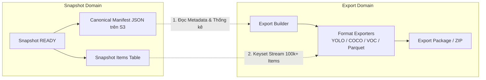

# Hướng Dẫn Tích Hợp & Đặc Tả Dữ Liệu Đầu Ra Snapshot (Handoff cho Export Domain)

**Tài liệu**: Đặc tả giao diện và hợp đồng dữ liệu giữa `Snapshot Domain` và `Export Domain`  
**Phiên bản Snapshot API**: `v1`  
**Cập nhật lần cuối**: 2026-11-19  
**Người phụ trách**: Backend Specialist / AI Platform Team  

---

## 1. Giới thiệu & Nguyên Tắc Tích Hợp

Export Domain tuân theo kiến trúc **Snapshot-driven Export**:
1. **Chỉ làm việc với Snapshot hợp lệ**: Export Job chỉ được phép khởi tạo từ một Snapshot có trạng thái `READY` (bất biến, đã được kiểm duyệt chất lượng và ontology).
2. **Không phụ thuộc dữ liệu sống**: Export Domain **tuyệt đối không** đọc trực tiếp từ các bảng `Dataset` hoặc `Annotation` đang chỉnh sửa.
3. **Toàn vẹn và tái lập (Reproducibility)**: Cùng một `snapshot_id` luôn cho ra một kết quả export duy nhất và nhất quán nhờ vào `item_checksum` và `aggregate_checksum`.
4. **Bảo vệ phụ thuộc (Active Dependency Guard)**: Khi một Snapshot đang được dùng trong Export Job hoặc Training Job đang chạy, Snapshot đó không thể bị xóa mềm hay purge.



---

## 2. Định Dạng Output 1: Canonical Manifest JSON (Lưu trữ trên S3 / MinIO)

Mỗi Snapshot khi hoàn tất tạo lập sẽ tự động upload một file manifest chuẩn hoá (RFC 8785 JSON Canonicalization) lên Object Storage.

* **S3 URI Pattern**: `s3://<bucket>/projects/{project_id}/snapshots/{snapshot_id}/manifest.json`
* **Content-Type**: `application/json`

### 2.1 Cấu trúc Schema JSON mẫu:
```json
{
  "snapshot_id": "01JXYZ98765432101234567890",
  "dataset_version_id": "01JABCDEF12345678901234567",
  "ontology_version_id": "01JBCDEF012345678901234567",
  "asset_count": 10000,
  "annotation_count": 9500,
  "split_distribution": {
    "train": {
      "count": 7000,
      "ratio": 0.70
    },
    "validation": {
      "count": 1500,
      "ratio": 0.15
    },
    "test": {
      "count": 1500,
      "ratio": 0.15
    }
  },
  "class_distribution": {
    "train": {
      "car": 4900,
      "pedestrian": 2100
    },
    "validation": {
      "car": 1050,
      "pedestrian": 450
    },
    "test": {
      "car": 1050,
      "pedestrian": 450
    }
  },
  "aggregate_checksum": "9f86d081884c7d659a2feaa0c55ad015a3bf4f1b2b0b822cd15d6c15b0f00a08",
  "created_at": "2026-11-19T09:30:25Z"
}
```

### 2.2 Ý nghĩa các trường:
| Trường | Kiểu dữ liệu | Mô tả cho Export Domain |
|---|---|---|
| `snapshot_id` | `string` (ULID) | Định danh duy nhất của snapshot được xuất. |
| `dataset_version_id` | `string` (ULID) | Phiên bản Dataset gốc (để truy vết provenance). |
| `ontology_version_id` | `string` (ULID) | Phiên bản Ontology dùng để gán nhãn, xuất classes.txt / categories. |
| `asset_count` | `integer` | Tổng số asset có trong snapshot. |
| `annotation_count` | `integer` | Tổng số asset có nhãn hợp lệ đi kèm. |
| `split_distribution` | `object` | Thống kê số lượng (`count`) và tỷ lệ thực tế (`ratio`) cho 3 tập: `train`, `validation`, `test`. |
| `class_distribution` | `object` | Tần số xuất hiện của từng label/class trên từng tập split (dùng cho phân tích cân bằng dữ liệu trong báo cáo export). |
| `aggregate_checksum` | `string` (SHA-256) | Mã băm toàn vẹn tổng hợp của toàn bộ snapshot. Export worker lưu mã này vào `package_manifest.json` để kiểm chứng sau khi đóng gói. |
| `created_at` | `string` (ISO-8601) | Thời điểm tạo snapshot. |

---

## 3. Định Dạng Output 2: API Keyset Streaming (Đọc danh sách Items)

Đối với các tập dữ liệu từ 10.000 đến hàng trăm nghìn mẫu, Export Domain **không đọc toàn bộ cùng lúc** mà stream từng batch qua Keyset / Cursor Pagination với chi phí $O(1)$ B-Tree seek time.

### 3.1 Endpoint
```http
GET /api/v1/projects/{project_id}/snapshots/{snapshot_id}/items
```

### 3.2 Query Parameters
| Tham số | Kiểu | Mặc định | Mô tả |
|---|---|---|---|
| `cursor` | `string` | `null` | ULID của item cuối cùng ở trang trước (`next_cursor`). Nếu null, bắt đầu từ đầu. |
| `limit` | `integer` | `100` | Số lượng item cần lấy mỗi trang (khuyến nghị cho export: `500` - `1000`, tối đa `1000`). |
| `split` | `string` | `null` | Lọc theo tập cụ thể nếu muốn xuất riêng: `train`, `validation`, hoặc `test`. Bỏ trống để lấy toàn bộ. |

### 3.3 Response Body (`HTTP 200 OK`)
```json
{
  "items": [
    {
      "id": "01JITEM000000000000000001",
      "snapshot_id": "01JXYZ98765432101234567890",
      "asset_id": "01JASSET12345678901234567",
      "annotation_revision_id": "01JREVISION12345678901234",
      "split": "train",
      "item_checksum": "e3b0c44298fc1c149afbf4c8996fb92427ae41e4649b934ca495991b7852b855",
      "sort_order": 0
    },
    {
      "id": "01JITEM000000000000000002",
      "snapshot_id": "01JXYZ98765432101234567890",
      "asset_id": "01JASSET12345678901234568",
      "annotation_revision_id": null,
      "split": "validation",
      "item_checksum": "9b12a44298fc1c149afbf4c8996fb92427ae41e4649b934ca495991b7852b111",
      "sort_order": 1
    }
  ],
  "next_cursor": "01JITEM000000000000000100",
  "total_count": 10000
}
```

### 3.4 Quy Tắc Dành Riêng Cho Export Exporter:
1. **Xử lý Ảnh không nhãn (Negative / Background Samples)**:
   - Khi `annotation_revision_id == null`: Đây là mẫu âm tính (asset hợp lệ nhưng không có bounding box/nhãn nào, xuất phát từ tuỳ chọn `include_unannotated=true`).
   - *YOLO format*: Tạo file text rỗng tương ứng (ví dụ `01JASSET12345678901234568.txt`).
   - *COCO format*: Thêm vào mảng `"images"` nhưng không tạo bản ghi nào trong mảng `"annotations"`.
2. **Kiểm tra tính toàn vẹn (Data Integrity Verification)**:
   - `item_checksum` là chuỗi SHA-256 tính trên payload canonical:
     ```json
     {"annotation_revision_id": "...", "asset_checksum": "...", "asset_id": "...", "split": "..."}
     ```
   - Export pipeline có thể dùng mã này để đảm bảo asset/nhãn không bị tráo đổi trong quá trình tải xuống.
3. **Dấu hiệu kết thúc stream**:
   - Khi `next_cursor` trả về `null`, client đã lấy hết toàn bộ dữ liệu.

---

## 4. Đoạn Mã Mẫu: Thuật Toán Stream Dữ Liệu Trong Export Worker

Export Worker có thể sử dụng pattern chuẩn sau đây bằng Python:

```python
import httpx

async def stream_snapshot_items_for_export(
    client: httpx.AsyncClient,
    base_url: str,
    project_id: str,
    snapshot_id: str,
    split: str | None = None,
    batch_size: int = 1000
):
    cursor = None
    total_processed = 0

    while True:
        params = {"limit": batch_size}
        if cursor:
            params["cursor"] = cursor
        if split:
            params["split"] = split

        resp = await client.get(
            f"{base_url}/api/v1/projects/{project_id}/snapshots/{snapshot_id}/items",
            params=params,
        )
        resp.raise_for_status()
        data = resp.json()

        items = data.get("items", [])
        if not items:
            break

        for item in items:
            # Yield hoặc xử lý trực tiếp từng item (tải ảnh, sinh format nhãn tương ứng)
            yield item
            total_processed += 1

        cursor = data.get("next_cursor")
        if not cursor:
            break

    print(f"Hoàn thành stream {total_processed} items từ snapshot {snapshot_id}")
```

---

## 5. API Release Tags (Xuất Theo Phiên Bản Đánh Dấu)

Người dùng thường muốn xuất phiên bản `production` hoặc `golden-v1` thay vì phải copy ID ULID:

* **Endpoint**: `GET /api/v1/projects/{project_id}/tags`
* **Response Body**:
```json
[
  {
    "name": "production",
    "snapshot_id": "01JXYZ98765432101234567890",
    "project_id": "01JPROJ123456789012345678",
    "created_by": 1001,
    "updated_at": "2026-11-19T09:35:00Z"
  }
]
```

Export Domain có thể cho phép người dùng nhập trực tiếp tag name: UI/CLI gọi endpoint này lấy `snapshot_id` trước khi khởi chạy Export Job.

---

## 6. Xử Lý Lỗi & Ngoại Lệ Thường Gặp (Error Matrix)

| Tình huống | Mã lỗi (`error_code`) | HTTP Status | Hướng dẫn xử lý cho Export Domain |
|---|---|---|---|
| Gọi Export khi Snapshot chưa xử lý xong | `snapshot_not_ready` | `400 Bad Request` | Kiểm tra status trước khi tạo Job. Chỉ chấp nhận `status == "READY"`. |
| Snapshot không tồn tại trong Project | `snapshot_not_found` | `404 Not Found` | Báo lỗi người dùng kiểm tra lại ID snapshot. |
| Người dùng yêu cầu xoá Snapshot khi đang chạy Export | `active_dependency_conflict` | `409 Conflict` | Snapshot Domain tự động chặn xoá, bảo vệ an toàn cho tiến trình Export. |
