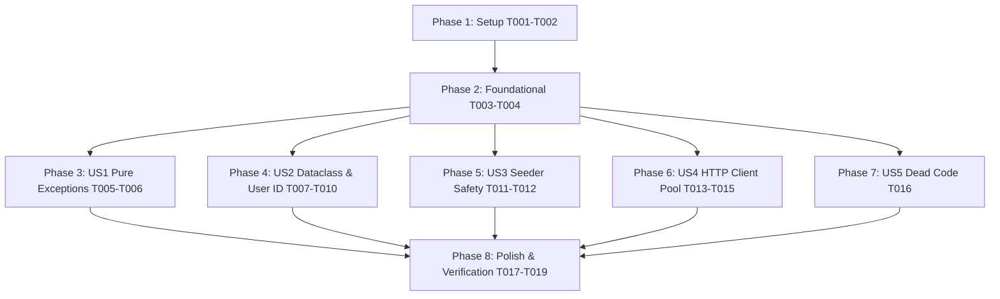

# Tasks: Remediation of Backend Code Smells & Clean Architecture Flaws

**Input**: Design documents from `specs/002-fix-clean-code-smells/` (`spec.md`, `plan.md`, `research.md`, `data-model.md`, `contracts/`, `quickstart.md`)

**Prerequisites**: `plan.md` (required), `spec.md` (required for user stories), `research.md`, `data-model.md`, `contracts/`

**Organization**: Tasks are grouped by user story to enable independent implementation and testing of each story.

## Format: `[ID] [P?] [Story] Description`

- **[P]**: Can run in parallel (different files, no dependencies)
- **[Story]**: Which user story this task belongs to (`[US1]`, `[US2]`, `[US3]`, `[US4]`, `[US5]`)
- Exact file paths included in every task description

---

## Phase 1: Setup & Baseline Verification

**Purpose**: Verify working environment and establish foundational global constants

- [x] T001 Verify virtual environment and existing test suite baseline via `uv run pytest tests/ -q`
- [x] T002 [P] Create `core/constants.py` defining `SYSTEM_USER_ID: int = 0` as the canonical sentinel ID for system/automated operations

---

## Phase 2: Foundational (Blocking Prerequisites)

**Purpose**: Core exception infrastructure that MUST be completed before User Story policies and handlers are refactored

**⚠️ CRITICAL**: No user story work can begin until this phase is complete

- [x] T003 Refactor `core/exceptions/base.py` to remove `status_code` from `DomainException(message: str, details: dict | None = None)` and establish protocol-agnostic exception classes (`InvariantViolationError`, `BusinessRuleViolationError`, `EntityNotFoundError`, `ConflictError`, `UnauthorizedError`, `ForbiddenError`, `OntologySeedingError`)
- [x] T004 Update presentation exception mapping in `core/exceptions/handlers.py` to map domain error classes to HTTP status codes (`EntityNotFoundError -> 404`, `ConflictError -> 409`, `UnauthorizedError -> 401`, `ForbiddenError -> 403`, `InvariantViolationError -> 400`, `BusinessRuleViolationError -> 400`) via `EXCEPTION_HTTP_STATUS_MAP`

**Checkpoint**: Foundation ready - domain exception hierarchy is protocol-agnostic; presentation layer handles HTTP status mapping.

---

## Phase 3: User Story 1 - Pure Domain Exceptions without Transport/HTTP Leaks (Priority: P1) 🎯 MVP

**Goal**: Purge all HTTP-specific exceptions (`BadRequestException`) and HTTP concepts from Domain Policies.

**Independent Test**: Execute Gate 1 from `specs/002-fix-clean-code-smells/quickstart.md`; verify `DatasetVersionPolicy` raises `BusinessRuleViolationError` without HTTP coupling.

- [x] T005 [P] [US1] Refactor `modules/dataset/domain/policies.py` to replace `from core.exceptions import BadRequestException` with `BusinessRuleViolationError` in `ensure_can_modify_draft` and `ensure_can_publish`
- [x] T006 [US1] Verify exception handling and serialization across dataset use cases in `modules/dataset/use_cases/` and ensure FastAPI handlers return HTTP 400 for policy violations

**Checkpoint**: User Story 1 complete. Domain policies are 100% protocol-agnostic.

---

## Phase 4: User Story 2 - Consistent User Identifier Typing & Clean Dataclasses (Priority: P1)

**Goal**: Standardize `user_id: int` across domain entities and database mappers, clean up fragmented `@dataclass` field declarations, and replace arbitrary `"system"` strings with `SYSTEM_USER_ID = 0`.

**Independent Test**: Execute Gate 2 from `specs/002-fix-clean-code-smells/quickstart.md`; verify clean dataclass field ordering and correct integer type enforcement.

- [x] T007 [P] [US2] Reformat `ProjectEntity` and `ProjectMemberEntity` in `modules/project/domain/entities.py` so all field declarations are contiguous at top, and `__post_init__` is placed at the bottom with fallback to `SYSTEM_USER_ID`
- [x] T008 [P] [US2] Standardize mapper casting to `int` in `modules/project/models/project.py` (`ProjectModel.to_entity` using `int(self.created_by) if str(self.created_by).isdigit() else SYSTEM_USER_ID` and `ProjectMemberModel.to_entity`)
- [x] T009 [P] [US2] Standardize mapper casting to `int` in `modules/annotation/models/annotation.py` (`AnnotationModel.to_entity` and `AnnotationRevisionModel.to_entity` using `int(self.created_by) if str(self.created_by).isdigit() else SYSTEM_USER_ID`)
- [x] T010 [US2] Replace `"system"` string fallback with `SYSTEM_USER_ID` constant in `apps/api/routers/annotation.py:94`

**Checkpoint**: User Story 2 complete. User identifiers are strictly typed as `int` without dirty inline `isdigit()` defensive code.

---

## Phase 5: User Story 3 - Safe Transaction Boundaries & Seeder Exception Propagation (Priority: P1)

**Goal**: Eliminate silent session rollback in `OntologyTemplateSeederService`, wrap seeding in transactional savepoints, and prevent ghost 201 Created responses.

**Independent Test**: Execute Gate 3 from `specs/002-fix-clean-code-smells/quickstart.md`; verify that `self.session.rollback()` is absent and savepoint isolates partial seeding failures.

- [x] T011 [US3] Remove `self.session.rollback()` and implement transactional savepoint (`async with self.session.begin_nested():`) in `modules/ontology/services/seeder.py`
- [x] T012 [US3] Verify `CreateOntologyUseCase` in `modules/ontology/use_cases/ontologies.py` retains transactional integrity during template seeding without ghost entity creation

**Checkpoint**: User Story 3 complete. Seeder failures never corrupt or unilaterally abort parent session transactions.

---

## Phase 6: User Story 4 - Persistent HTTP Client Connection Pooling (Priority: P2)

**Goal**: Eliminate per-request `httpx.AsyncClient` instantiation and connection leaks in `AuthClient` and `ManageClient` by managing a shared pooled client in Dishka DI.

**Independent Test**: Execute Gate 5 from `specs/002-fix-clean-code-smells/quickstart.md`; verify that `AuthClient` receives injected `httpx.AsyncClient` with connection pooling enabled.

- [x] T013 [US4] Configure application-scoped (`Scope.APP`) pooled `httpx.AsyncClient` provider with connection limits (`max_keepalive_connections=20`, `max_connections=100`) in `modules/identity/di.py`
- [x] T014 [P] [US4] Refactor `modules/identity/client/auth_client.py` to receive injected `httpx.AsyncClient` in `__init__`, remove per-call `async with httpx.AsyncClient(...)`, and replace `HTTPException` with domain/infrastructure exceptions
- [x] T015 [P] [US4] Refactor `modules/identity/client/manage_client.py` to receive injected `httpx.AsyncClient` in `__init__`, remove per-call `async with httpx.AsyncClient(...)`, and replace `HTTPException` with domain/infrastructure exceptions

**Checkpoint**: User Story 4 complete. Connection pooling eliminates 20-60ms handshake latency per external call.

---

## Phase 7: User Story 5 - Dead Code Elimination (Priority: P3)

**Goal**: Eradicate 144 lines of orphaned, superseded code in `modules/ontology/use_cases/ontologies.py`.

**Independent Test**: Execute Gate 4 from `specs/002-fix-clean-code-smells/quickstart.md`; verify `seed_ontology_from_template` is deleted and tests pass.

- [x] T016 [US5] Delete legacy `seed_ontology_from_template` function (lines 47-191) and unreferenced repository imports in `modules/ontology/use_cases/ontologies.py`

**Checkpoint**: User Story 5 complete. Dead code completely removed.

---

## Phase 8: Polish & Automated Gate Verification

**Purpose**: Multi-layer verification, code formatting, and full regression testing across all modules

- [x] T017 [P] Execute all 5 verification gates from `specs/002-fix-clean-code-smells/quickstart.md`
- [x] T018 Run full regression test suite `uv run pytest tests/ -q` to confirm 100% of tests pass (111 tests passing)
- [x] T019 Run ruff linter check `uv run ruff check apps/ modules/ core/` and format check `uv run ruff format --check apps/ modules/ core/`

---

## Dependencies & Execution Order

### Phase Dependencies

- **Phase 1 (Setup)**: Can start immediately.
- **Phase 2 (Foundational)**: Blocks US1, US2, US3, US4, US5.
- **Phase 3-7 (User Stories)**: Can proceed in parallel once Phase 2 completes, or sequentially by priority (US1 -> US2 -> US3 -> US4 -> US5).
- **Phase 8 (Polish)**: Runs after all user story phases complete.

### Parallel Opportunities

- **Setup Phase**: T002 can run in parallel with T001.
- **User Story 2**: T007, T008, T009 can run in parallel (different files in different modules).
- **User Story 4**: T014 and T015 can run in parallel after T013 completes.
- **Final Polish**: T017, T018, T019 can execute sequentially to validate gates then regression.

---

## Implementation Strategy

### MVP First (Phases 1-3)
1. Complete Setup + Foundational (T001-T004)
2. Complete User Story 1 (T005-T006)
3. Validate Gate 1 independently: Pure Domain Exceptions operational.

### Incremental Delivery
1. Foundation + US1 (Pure Exceptions) -> Validate Gate 1
2. Add US2 (User ID & Dataclasses) -> Validate Gate 2
3. Add US3 (Seeder Session Safety) -> Validate Gate 3
4. Add US4 (Pooled HTTP Client) -> Validate Gate 5
5. Add US5 (Dead Code Removal) -> Validate Gate 4
6. Run full regression test suite (111 tests passing) -> Delivery complete.
