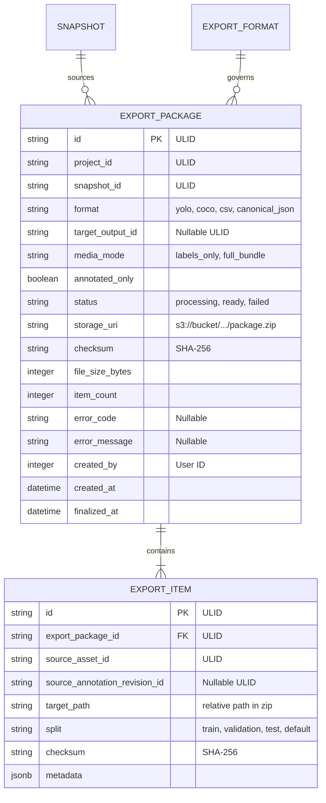

# Phase 1: Data Model & Schema Design

**Feature**: Snapshot-Driven Data Export  
**Branch**: `002-snapshot-export`  
**Date**: 2026-11-20  

---

## 1. Conceptual Domain Entities & Invariants



---

## 2. Value Objects & Enumerations

### 2.1 `ExportStatus` (Enum)
```python
class ExportStatus(str, Enum):
    PROCESSING = "processing"
    READY = "ready"
    FAILED = "failed"
```

### 2.2 `ExportFormatType` (Enum)
```python
class ExportFormatType(str, Enum):
    CANONICAL_JSON = "canonical_json"
    CANONICAL_JSONL = "canonical_jsonl"
    YOLO = "yolo"
    COCO = "coco"
    CSV = "csv"
```

### 2.3 `MediaMode` (Enum)
```python
class MediaMode(str, Enum):
    LABELS_ONLY = "labels_only"
    FULL_BUNDLE = "full_bundle"
```

---

## 3. Domain Entities (Pure Python)

```python
@dataclass
class ExportItemEntity:
    id: str
    export_package_id: str
    source_asset_id: str
    source_annotation_revision_id: str | None
    target_path: str
    split: str
    checksum: str
    metadata: dict[str, Any] = field(default_factory=dict)


@dataclass
class ExportPackageEntity:
    id: str
    project_id: str
    snapshot_id: str
    format: ExportFormatType
    target_output_id: str | None
    media_mode: MediaMode
    annotated_only: bool
    status: ExportStatus
    storage_uri: str | None
    checksum: str | None
    file_size_bytes: int | None
    item_count: int
    error_code: str | None
    error_message: str | None
    created_by: int
    created_at: datetime
    finalized_at: datetime | None

    def mark_ready(self, storage_uri: str, checksum: str, file_size_bytes: int, item_count: int) -> None:
        self.status = ExportStatus.READY
        self.storage_uri = storage_uri
        self.checksum = checksum
        self.file_size_bytes = file_size_bytes
        self.item_count = item_count
        self.finalized_at = datetime.now(timezone.utc)

    def mark_failed(self, error_code: str, error_message: str) -> None:
        self.status = ExportStatus.FAILED
        self.error_code = error_code
        self.error_message = error_message
        self.finalized_at = datetime.now(timezone.utc)
```

---

## 4. PostgreSQL Relational Persistence Model

### 4.1 Table: `export_packages`

```sql
CREATE TABLE export_packages (
    id VARCHAR(26) PRIMARY KEY,
    project_id VARCHAR(26) NOT NULL REFERENCES projects(id) ON DELETE CASCADE,
    snapshot_id VARCHAR(26) NOT NULL REFERENCES snapshots(id) ON DELETE CASCADE,
    format VARCHAR(50) NOT NULL,
    target_output_id VARCHAR(26) NULL,
    media_mode VARCHAR(20) NOT NULL DEFAULT 'labels_only',
    annotated_only BOOLEAN NOT NULL DEFAULT FALSE,
    status VARCHAR(20) NOT NULL DEFAULT 'processing',
    storage_uri VARCHAR(512) NULL,
    checksum VARCHAR(64) NULL,
    file_size_bytes BIGINT NULL,
    item_count INTEGER NOT NULL DEFAULT 0,
    error_code VARCHAR(100) NULL,
    error_message TEXT NULL,
    created_by INTEGER NOT NULL,
    created_at TIMESTAMP WITH TIME ZONE DEFAULT NOW() NOT NULL,
    finalized_at TIMESTAMP WITH TIME ZONE NULL,
    CONSTRAINT uq_export_package_idempotency UNIQUE (
        snapshot_id, format, target_output_id, media_mode, annotated_only
    )
);

CREATE INDEX ix_export_packages_project ON export_packages(project_id, created_at DESC);
CREATE INDEX ix_export_packages_snapshot ON export_packages(snapshot_id);
CREATE INDEX ix_export_packages_status ON export_packages(status);
```

### 4.2 Table: `export_items`

```sql
CREATE TABLE export_items (
    id VARCHAR(26) PRIMARY KEY,
    export_package_id VARCHAR(26) NOT NULL REFERENCES export_packages(id) ON DELETE CASCADE,
    source_asset_id VARCHAR(26) NOT NULL,
    source_annotation_revision_id VARCHAR(26) NULL,
    target_path VARCHAR(512) NOT NULL,
    split VARCHAR(50) NOT NULL DEFAULT 'default',
    checksum VARCHAR(64) NOT NULL,
    metadata JSONB NOT NULL DEFAULT '{}'::jsonb
);

CREATE INDEX ix_export_items_package ON export_items(export_package_id);
CREATE INDEX ix_export_items_asset ON export_items(source_asset_id);
```

---

## 5. Storage Layout (MinIO / S3)

Export archives follow an immutable path scheme:
```text
s3://<default-bucket>/projects/{project_id}/exports/{export_package_id}/package.zip
```

Internal structure of `package.zip`:
```text
package.zip
├── manifest.json              # Package metadata, lineage hashes, class maps, summary
├── labels/                    # Format-specific labels
│   ├── train/
│   │   ├── 01ASSET001.txt
│   │   └── 01ASSET002.txt
│   └── val/
│       └── 01ASSET003.txt
├── data.yaml                  # (For YOLO: classes & split paths)
└── images/                    # (Present ONLY in full_bundle mode)
    ├── train/
    │   └── 01ASSET001.jpg
    └── val/
        └── 01ASSET003.jpg
```
