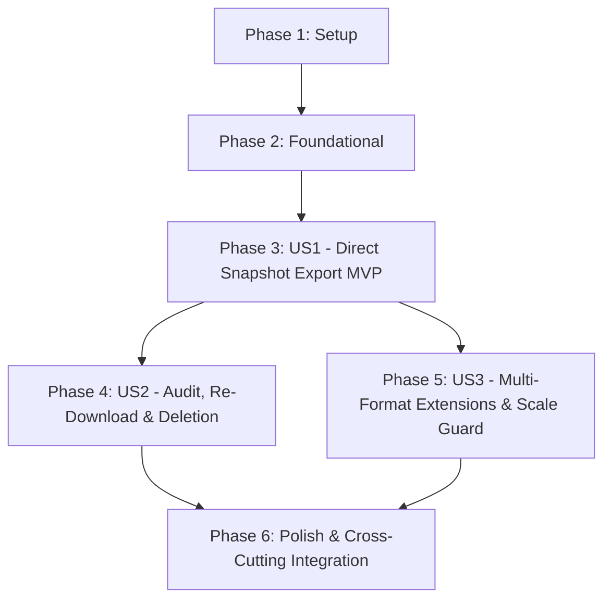

# Tasks: Snapshot-Driven Data Export

**Input**: Design documents from `specs/002-snapshot-export/` (`spec.md`, `plan.md`, `research.md`, `data-model.md`, `contracts/export-api.yaml`, `quickstart.md`)  
**Prerequisites**: `plan.md`, `spec.md`, `data-model.md`, `research.md`, `contracts/`  
**Constitution**: Strict adherence to Domain Purity, Integer User IDs (`created_by: int`), Explicit Session Boundaries, and Dishka DI.

---

## Phase 1: Setup (Module Structure & Database Migration)

**Purpose**: Initialize module layout and database schema for Export Domain.

- [X] T001 Create module directory structure `modules/export/` (`domain/`, `application/`, `infrastructure/`, `services/`) per implementation plan
- [X] T002 Create Alembic database migration in `migrations/versions/015_create_export_domain_tables.py` for tables `export_packages` and `export_items` with unique constraint `uq_export_package_idempotency` (`snapshot_id`, `format`, `target_output_id`, `media_mode`, `annotated_only`)

---

## Phase 2: Foundational (Core Domain & Infrastructure)

**Purpose**: Core domain entities, value objects, exceptions, and infrastructure gateways required by all user stories.

**⚠️ CRITICAL**: Must be completed before any User Story implementation begins.

- [X] T003 [P] Implement domain value objects `ExportStatus`, `ExportFormatType`, and `MediaMode` in `modules/export/domain/value_objects.py`
- [X] T004 [P] Implement domain exceptions `IncompatibleFormatError`, `SnapshotNotReadyError`, `ScaleLimitExceededError`, and `ExportPackageNotFoundError` inheriting from `DomainException` in `modules/export/domain/exceptions.py`
- [X] T005 [P] Implement pure domain entities `ExportPackageEntity` (with `created_by: int`, `status: ExportStatus`, `file_size_bytes: int | None`) and `ExportItemEntity` in `modules/export/domain/entities.py`
- [X] T006 [P] Define domain repository and gateway interfaces `IExportPackageRepository`, `IExportItemRepository`, `ISnapshotGateway`, and `IStorageGateway` in `modules/export/domain/interfaces.py`
- [X] T007 [P] Implement SQLAlchemy persistence models `ExportPackageModel` and `ExportItemModel` in `modules/export/infrastructure/persistence/models.py`
- [X] T008 [P] Implement `SqlExportPackageRepository` with idempotency lookup and status update methods in `modules/export/infrastructure/repositories/export_package_repository.py`
- [X] T009 [P] Implement `SqlExportItemRepository` for batch item persistence and querying in `modules/export/infrastructure/repositories/export_item_repository.py`
- [X] T010 [P] Implement `SnapshotGateway` adapter to read manifest and stream items from `modules.snapshot` in `modules/export/infrastructure/gateways/snapshot_gateway.py`
- [X] T011 [P] Implement `S3StorageGateway` adapter for uploading zip packages and generating 30-minute Presigned URLs in `modules/export/infrastructure/gateways/s3_storage_gateway.py`

**Checkpoint**: Foundation ready — Domain and persistence layers verified and testable.

---

## Phase 3: User Story 1 - Direct Snapshot Export to Immutable Package (Priority: P1) 🎯 MVP

**Goal**: Deliver the core end-to-end export capability: take a valid, finalized Snapshot and transform it into an immutable, verifiable `.zip` package (YOLO & Canonical JSON) with manifest and SHA-256 checksum via an asynchronous HTTP 202 endpoint.

**Independent Test**: Can be verified by executing `POST /api/v1/projects/{project_id}/snapshots/{snapshot_id}/exports` with format `yolo`, polling until status is `ready`, downloading the generated `.zip` bundle, and verifying label paths, `data.yaml`, and SHA-256 checksum.

### Tests for User Story 1 ⚠️

- [X] T012 [P] [US1] Unit tests for `ExportPackageEntity` idempotency, state transitions (`mark_ready`, `mark_failed`), and validation in `tests/test_export_domain_unit.py`
- [X] T013 [P] [US1] Unit tests for `ArchiverService` (.zip assembly, internal `manifest.json`, and SHA-256 checksum generation) in `tests/test_archiver_service.py`
- [X] T014 [P] [US1] Unit tests for `YoloExporter` (bounding box coordinate normalization `[class x y w h]`, split directory layout, `data.yaml`) in `tests/test_yolo_exporter.py`
- [X] T015 [P] [US1] Integration test for `POST .../exports` (HTTP 202 response, worker dispatch, idempotent replay returning HTTP 200) in `tests/test_export_api_full.py`

### Implementation for User Story 1

- [X] T016 [P] [US1] Define abstract `IFormatExporter` protocol and `ExportContext` in `modules/export/domain/services/base_exporter.py`
- [X] T017 [P] [US1] Implement `ArchiverService` for streaming zip creation and SHA-256 hashing in `modules/export/domain/services/archiver_service.py`
- [X] T018 [P] [US1] Implement `CanonicalJsonExporter` (exporting raw multi-output items to JSON/JSONL) in `modules/export/domain/services/canonical_exporter.py`
- [X] T019 [P] [US1] Implement `YoloExporter` (normalizing bbox coordinates, mapping split directories `labels/train/`, `labels/val/`) in `modules/export/domain/services/yolo_exporter.py`
- [X] T020 [US1] Implement `ExportWorker` background processor (fetching snapshot items, invoking matching exporter, archiving zip, computing checksum, marking `READY`) in `modules/export/infrastructure/background/export_worker.py`
- [X] T021 [US1] Implement `CreateExportPackageUseCase` (idempotency check, scale limit check, persisting `PROCESSING` package, firing worker task) in `modules/export/application/use_cases/create_export_package.py`
- [X] T022 [US1] Implement DTO schemas `ExportCreateRequest` and `ExportPackageResponse` in `modules/export/application/dtos/export_dtos.py`
- [X] T023 [US1] Implement REST endpoint `POST /api/v1/projects/{project_id}/snapshots/{snapshot_id}/exports` with Owner/Admin RBAC check in `apps/api/routers/export/exports.py`

**Checkpoint**: User Story 1 is fully functional and testable as an MVP increment.

---

## Phase 4: User Story 2 - Traceability, Audit, Re-Download & Deletion (Priority: P2)

**Goal**: Enable Data Managers and Auditors to inspect export history, trace exported items to source assets and annotation revisions, obtain time-limited presigned URLs to re-download existing packages, and delete packages to reclaim storage.

**Independent Test**: Can be verified by listing completed export packages, querying package details, retrieving a 30-minute presigned download link via `GET .../download`, and deleting the package via `DELETE .../exports/{package_id}` confirming MinIO purge.

### Tests for User Story 2 ⚠️

- [X] T024 [P] [US2] Unit test for item-level traceability mapping in `tests/test_export_traceability.py`
- [X] T025 [P] [US2] Integration test for package listing, package detail, presigned download redirect, and deletion in `tests/test_export_lifecycle_api.py`

### Implementation for User Story 2

- [X] T026 [P] [US2] Implement `GetExportPackageUseCase` (fetch package details and lineage statistics) in `modules/export/application/use_cases/get_export_package.py`
- [X] T027 [P] [US2] Implement `ListExportPackagesUseCase` (paginated query by project and optional snapshot/status filters) in `modules/export/application/use_cases/list_export_packages.py`
- [X] T028 [P] [US2] Implement `GetExportDownloadUrlUseCase` (validate package is READY and generate 30-minute presigned S3 GET URL) in `modules/export/application/use_cases/get_export_download_url.py`
- [X] T029 [P] [US2] Implement `DeleteExportPackageUseCase` (purge `.zip` archive on MinIO/S3 and delete package records) in `modules/export/application/use_cases/delete_export_package.py`
- [X] T030 [US2] Implement REST endpoints `GET /projects/{project_id}/exports`, `GET /projects/{project_id}/exports/{package_id}`, `GET /projects/{project_id}/exports/{package_id}/download`, and `DELETE /projects/{project_id}/exports/{package_id}` in `apps/api/routers/export/exports.py`

**Checkpoint**: User Stories 1 & 2 complete; full audit, traceability, download, and cleanup workflows operational.

---

## Phase 5: User Story 3 - Multi-Format Extensions & Scale Limits (Priority: P3)

**Goal**: Support additional machine learning formats (**COCO** for vision, **CSV** for classification/tabular), enforce `target_output_id` validation for single-task formats, and enforce upfront scale limit protection (max 2 GB / 5,000 files in Full Bundle mode).

**Independent Test**: Can be verified by exporting a dataset in COCO and CSV formats, verifying format structural compliance, and testing that requests exceeding the 2 GB / 5,000 file threshold in Full Bundle mode are rejected upfront with HTTP 400.

### Tests for User Story 3 ⚠️

- [X] T031 [P] [US3] Unit tests for `CocoExporter` (`images`, `annotations`, `categories` schemas, split partitions) in `tests/test_coco_exporter.py`
- [X] T032 [P] [US3] Unit tests for `CsvExporter` (tabular and text classification flattening, split columns) in `tests/test_csv_exporter.py`
- [X] T033 [P] [US3] Unit and integration tests for Full Bundle scale guard (rejecting >2 GB or >5,000 files) in `tests/test_scale_guard.py`

### Implementation for User Story 3

- [X] T034 [P] [US3] Implement `CocoExporter` (formatting vision annotations to COCO JSON specification) in `modules/export/domain/services/coco_exporter.py`
- [X] T035 [P] [US3] Implement `CsvExporter` (flattening classification and tabular data with split assignment) in `modules/export/domain/services/csv_exporter.py`
- [X] T036 [US3] Implement scale limit validation logic in `CreateExportPackageUseCase` and `ExportWorker` enforcing constraints $\le 2\text{ GB}$ or $\le 5,000$ files when `media_mode == "full_bundle"`
- [X] T037 [US3] Implement media fetching and packaging logic inside `ExportWorker` for `media_mode == "full_bundle"`
- [X] T038 [US3] Register `CocoExporter` and `CsvExporter` in format exporter registry

**Checkpoint**: Multi-format matrix complete; scale protection operational across all formats.

---

## Phase 6: Polish & Cross-Cutting Integration

**Purpose**: System wiring, dependency injection integration, verification, and code quality checks.

- [X] T039 Implement Dishka DI provider `ExportProvider` binding repositories, gateways, exporters, worker, and use cases in `modules/export/di.py`
- [X] T040 Register `ExportProvider` in application container `apps/api/di.py` and mount router in `apps/api/main.py`
- [X] T041 Run database migration `uv run alembic upgrade head` and verify table creation
- [X] T042 Run full automated test suite `uv run pytest tests/` with zero failures
- [X] T043 Run static type checking `uv run mypy modules/export apps/api/routers/export`
- [X] T044 Run formatting and lint checks `uv run ruff check .` and `uv run ruff format .`
- [X] T045 Execute end-to-end validation scenarios documented in `quickstart.md`

---

## Dependencies & Execution Order

### Phase Dependencies

- **Phase 1 (Setup)**: Can start immediately.
- **Phase 2 (Foundational)**: Depends on Phase 1; BLOCKS all user stories.
- **Phase 3 (User Story 1 - MVP)**: Depends on Phase 2. Delivers working core export.
- **Phase 4 (User Story 2)**: Depends on Phase 3 (extends package with download, query, delete).
- **Phase 5 (User Story 3)**: Depends on Phase 3 (adds COCO, CSV exporters and full-bundle scale guard).
- **Phase 6 (Polish)**: Depends on all user stories.

---

## Implementation Strategy (MVP First)

1. **Step 1**: Complete Phase 1 (Setup) and Phase 2 (Foundational).
2. **Step 2**: Complete Phase 3 (User Story 1).
3. **STOP and VALIDATE**: Test exporting a Snapshot to YOLO format using `tests/test_export_api_full.py`. You have a working, demonstrable MVP!
4. **Step 3**: Implement Phase 4 (User Story 2) for download URLs, history, and cleanup.
5. **Step 4**: Implement Phase 5 (User Story 3) for COCO, CSV, and scale guard.
6. **Step 5**: Complete Phase 6 for system-wide verification and linting.
