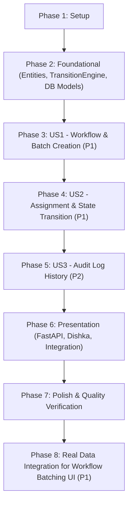

# Tasks: Workflow Domain Management

**Input**: Design documents from `specs/002-workflow-domain/` (`spec.md`, `plan.md`, `data-model.md`, `contracts/domain-interfaces.md`, `research.md`, `quickstart.md`)

**Prerequisites**: plan.md (completed), spec.md (completed), data-model.md (completed), contracts/ (completed)

**Organization**: Tasks are grouped by foundational infrastructure and user stories to enable independent, testable increments conforming to Clean Architecture / DDD.

## Format: `[ID] [P?] [Story] Description`

- **[P]**: Can run in parallel (different files, no dependencies)
- **[Story]**: Which user story this task belongs to (`US1` = Workflow & Batch Creation, `US2` = Assignment & Transition Engine, `US3` = Audit Log History)
- Exact file paths included in every task

---

## Phase 1: Setup & Module Scaffolding

**Purpose**: Initialize directory layout for `modules/workflow/` according to Clean Architecture guidelines.

- [x] T001 Create directory structure for `modules/workflow/` (`domain/`, `application/`, `infrastructure/`, `presentation/`)
- [x] T002 [P] Create `modules/workflow/__init__.py` and all package initialization files across subdirectories
- [x] T003 [P] Create test directory structure under `tests/modules/workflow/unit/` and `tests/modules/workflow/integration/`

---

## Phase 2: Foundational (Domain Entities, State Engine & Database Schema)

**Purpose**: Core pure domain entities, state machine transition rules, and database schema that MUST be complete before use case execution.

**⚠️ CRITICAL**: No user story use cases can proceed until foundational domain entities and persistence tables exist.

- [x] T004 [P] Implement pure domain entities and enums (`WorkItemStatus`, `WorkItemPriority`, `WorkflowDefinitionEntity`, `WorkItemEntity`, `AssignmentEntity`, `WorkflowHistoryEntity`) in `modules/workflow/domain/entities/workflow.py`
- [x] T005 [P] Implement domain exceptions (`InvalidStateTransitionError`, `WorkItemNotFoundError`, `WorkflowDefinitionNotFoundError`, `InvalidAssignmentError`) in `modules/workflow/domain/exceptions/workflow_exceptions.py`
- [x] T006 Implement pure domain `TransitionEngine` validating allowed state transitions and terminal states in `modules/workflow/domain/services/transition_engine.py`
- [x] T007 [P] Implement abstract repository protocols (`IWorkflowDefinitionRepository`, `IWorkItemRepository`, `IAssignmentRepository`, `IWorkflowHistoryRepository`) in `modules/workflow/domain/interfaces/repositories.py`
- [x] T008 [P] Unit test pure domain `TransitionEngine` for valid transitions, illegal jumps, and cancellation boundary rules in `tests/modules/workflow/unit/test_transition_engine.py`
- [x] T009 Define SQLAlchemy ORM mapped models (`WorkflowDefinitionModel`, `WorkItemModel`, `AssignmentModel`, `WorkflowHistoryModel`) in `modules/workflow/infrastructure/persistence/models.py`
- [x] T010 Create Alembic migration script for workflow tables in `migrations/versions/`

**Checkpoint**: Core domain rules, state machine, and persistence layer ready.

---

## Phase 3: User Story 1 - Workflow Definition & Batch Work Item Creation (Priority: P1) 🎯 MVP

**Goal**: Allow project managers to define workflow schemas and create Work Items (individual resources or batched asset groups like `ANNOTATION_BATCH`) for a project.

**Independent Test**: Create a workflow definition and generate a batch of 50 assets as a single Work Item (`resource_type="ANNOTATION_BATCH"`), verifying `CREATED` status.

### Tests for User Story 1

- [x] T011 [P] [US1] Unit test `CreateWorkflowDefinitionUseCase` in `tests/modules/workflow/unit/test_create_workflow_definition.py`
- [x] T012 [P] [US1] Unit test `CreateBatchWorkItemsUseCase` in `tests/modules/workflow/unit/test_create_batch_work_items.py`

### Implementation for User Story 1

- [x] T013 [P] [US1] Implement Pydantic DTO schemas for workflow definition and batch creation in `modules/workflow/application/dtos/workflow_dtos.py`
- [x] T014 [US1] Implement `WorkflowDefinitionRepository` using SQLAlchemy in `modules/workflow/infrastructure/repositories/workflow_definition_repository.py`
- [x] T015 [US1] Implement `WorkItemRepository` (including `create` and `create_batch`) in `modules/workflow/infrastructure/repositories/work_item_repository.py`
- [x] T016 [US1] Implement `CreateWorkflowDefinitionUseCase` in `modules/workflow/application/use_cases/create_workflow_definition.py`
- [x] T017 [US1] Implement `CreateBatchWorkItemsUseCase` with batch partition grouping logic in `modules/workflow/application/use_cases/create_batch_work_items.py`

**Checkpoint**: Workflow definitions and Work Items / Batches can be created and queried.

---

## Phase 4: User Story 2 - Work Item Assignment, Bulk Distribution & State Progression (Priority: P1)

**Goal**: Distribute Work Items across annotators (individually or via bulk round-robin) and transition states through `TransitionEngine` with row-level locking.

**Independent Test**: Bulk-assign 10 items across 2 annotators, advance an item through `Assigned` -> `InProgress` -> `Submitted` -> `Approved` -> `Completed`, and verify illegal transitions are rejected.

### Tests for User Story 2

- [x] T018 [P] [US2] Unit test `BulkAssignWorkItemsUseCase` in `tests/modules/workflow/unit/test_bulk_assign_work_items.py`
- [x] T019 [P] [US2] Unit test `TransitionWorkItemUseCase` (including feedback comment and cancellation) in `tests/modules/workflow/unit/test_transition_work_item.py`

### Implementation for User Story 2

- [x] T020 [P] [US2] Implement Pydantic DTO schemas for assignment, bulk assignment, and state transitions in `modules/workflow/application/dtos/workflow_dtos.py`
- [x] T021 [US2] Implement `AssignmentRepository` in `modules/workflow/infrastructure/repositories/assignment_repository.py`
- [x] T022 [US2] Add row-level locking (`SELECT ... FOR UPDATE`) in `WorkItemRepository.get_by_id_for_update` in `modules/workflow/infrastructure/repositories/work_item_repository.py`
- [x] T023 [US2] Implement `BulkAssignWorkItemsUseCase` (even round-robin distribution across annotator IDs) in `modules/workflow/application/use_cases/bulk_assign_work_items.py`
- [x] T024 [US2] Implement `TransitionWorkItemUseCase` integrating `TransitionEngine`, state update, and reviewer comments in `modules/workflow/application/use_cases/transition_work_item.py`

**Checkpoint**: End-to-end assignment and lifecycle transitions working with strict concurrency control.

---

## Phase 5: User Story 3 - Audit Log & History Tracking (Priority: P2)

**Goal**: Provide an immutable audit trail of all lifecycle events (`from_state`, `to_state`, `changed_by`, `comment`, `changed_at`) for compliance and debugging.

**Independent Test**: Perform multiple state transitions on a Work Item and verify that `GetWorkItemHistoryUseCase` returns a chronological list of changes.

### Tests for User Story 3

- [x] T025 [P] [US3] Unit test `GetWorkItemHistoryUseCase` in `tests/modules/workflow/unit/test_get_work_item_history.py`

### Implementation for User Story 3

- [x] T026 [P] [US3] Implement `WorkflowHistoryRepository` in `modules/workflow/infrastructure/repositories/history_repository.py`
- [x] T027 [US3] Integrate immutable history recording into `TransitionWorkItemUseCase`
- [x] T028 [US3] Implement `GetWorkItemHistoryUseCase` in `modules/workflow/application/use_cases/get_work_item_history.py`

**Checkpoint**: Full audit logging active for every state change.

---

## Phase 6: Presentation, Dependency Injection & Integration

**Purpose**: Expose REST endpoints via FastAPI, configure Dishka dependency injection, and run integration tests.

- [x] T029 Configure Dishka DI provider for workflow services and repositories in `modules/workflow/infrastructure/di/provider.py`
- [x] T030 Implement FastAPI router for workflow definitions and work items in `modules/workflow/presentation/api/routes.py`
- [x] T031 Mount workflow router into main application API in `apps/api/main.py`
- [x] T032 [P] Write integration tests for end-to-end workflow API endpoints in `tests/modules/workflow/integration/test_workflow_api.py`
- [x] T033 Execute quickstart validation scenarios from `specs/002-workflow-domain/quickstart.md`

---

## Phase 7: Polish & Cross-Cutting Concerns

**Purpose**: Performance verification, code quality, and documentation.

- [x] T034 [P] Verify state transition p95 response time (<150ms) with synthetic benchmark in `tests/modules/workflow/integration/test_performance.py`
- [x] T035 [P] Code cleanup, typing verification with mypy/ruff on `modules/workflow/`
- [x] T036 Review completed implementation against `specs/002-workflow-domain/checklists/comprehensive-quality.md`

---

## Phase 8: Real Data Integration for Workflow Batching UI (Priority: P1) 🎯 Focus

**Goal**: Connect `CreateBatchModal` to real dataset assets from backend API, displaying the actual asset count in the database and slicing real asset UUIDs into batches.

**Independent Test**: Open "+ Khởi tạo Lô công việc" in a project with datasets, verify the modal lists real datasets and versions, displays the accurate total asset count from the database, and partitions real asset IDs into created batches.

### Implementation Tasks for Real Data Integration

- [ ] T037 [P] [US1] Update `CreateBatchWorkItemsRequest` DTO to accept optional `dataset_id` and `dataset_version_id` in `modules/workflow/application/dtos/workflow_dtos.py`
- [ ] T038 [US1] Update `CreateBatchWorkItemsUseCase` to store `dataset_id` and `dataset_version_id` in `WorkItemEntity.metadata` in `modules/workflow/application/use_cases/create_batch_work_items.py`
- [ ] T039 [P] [US1] Update frontend workflow types and mutation payload to support `dataset_id` and `dataset_version_id` in `web/src/features/workflow/types/index.ts`
- [ ] T040 [US1] Integrate `useProjectDatasetsQuery` into `CreateBatchModal` to fetch real project datasets and versions in `web/src/features/workflow/components/create-batch-modal.tsx`
- [ ] T041 [US1] Integrate `useVersionAssetsQuery` into `CreateBatchModal` to retrieve real asset list and display actual total asset count in `web/src/features/workflow/components/create-batch-modal.tsx`
- [ ] T042 [US1] Implement dataset/version selector controls, zero-asset warning notice, and client-side chunking by real `asset.id` UUIDs in `web/src/features/workflow/components/create-batch-modal.tsx`
- [ ] T043 [P] [US1] Verify frontend typecheck and compilation with `npm --prefix web run typecheck`
- [x] T037 [P] [US1] Update `CreateBatchWorkItemsRequest` DTO to accept optional `dataset_id` and `dataset_version_id` in `modules/workflow/application/dtos/workflow_dtos.py`
- [x] T038 [US1] Update `CreateBatchWorkItemsUseCase` to store `dataset_id` and `dataset_version_id` in `WorkItemEntity.metadata` in `modules/workflow/application/use_cases/create_batch_work_items.py`
- [x] T039 [P] [US1] Update frontend workflow types and mutation payload to support `dataset_id` and `dataset_version_id` in `web/src/features/workflow/types/index.ts`
- [x] T040 [US1] Integrate `useProjectDatasetsQuery` into `CreateBatchModal` to fetch real project datasets and versions in `web/src/features/workflow/components/create-batch-modal.tsx`
- [x] T041 [US1] Integrate `useVersionAssetsQuery` into `CreateBatchModal` to retrieve real asset list and display actual total asset count in `web/src/features/workflow/components/create-batch-modal.tsx`
- [x] T042 [US1] Implement dataset/version selector controls, zero-asset warning notice, and client-side chunking by real `asset.id` UUIDs in `web/src/features/workflow/components/create-batch-modal.tsx`
- [x] T043 [P] [US1] Verify frontend typecheck and compilation with `npm --prefix web run typecheck`

---

## Dependencies & Execution Order

### Parallel Execution Opportunities for Phase 8

1. **Parallel Backend & Types Scaffolding**:
   - `T037` (`workflow_dtos.py`) and `T039` (`web/src/features/workflow/types/index.ts`) can be implemented in parallel.
2. **Sequential UI Integration**:
   - `T038` updates use case.
   - `T040`, `T041`, `T042` update `CreateBatchModal`.
   - `T043` verifies TypeScript compilation.
