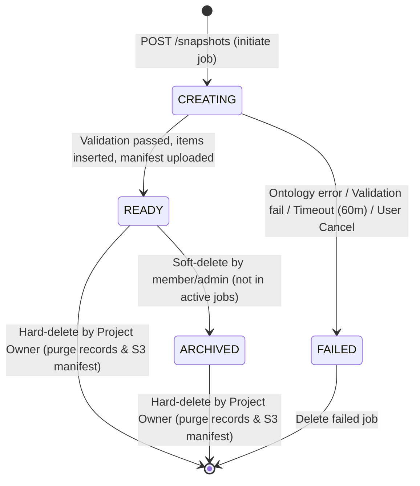

# Data Model: Snapshot Domain & Immutable Dataset Publishing

**Feature Branch**: `004-snapshot-domain`  
**Date**: 2026-11-19  
**Status**: Final  

---

## 1. Domain Entities & Value Objects (Pure Python)

Conforming strictly to **Constitution Principle I** (Pure Domain Purity & Protocol Agnosticism), all domain entities, value objects, and domain errors are pure Python classes (`@dataclass`) with zero dependencies on SQLAlchemy, Pydantic, or FastAPI.

### 1.1 Value Objects

```python
from dataclasses import dataclass
from typing import Literal

SnapshotStatus = Literal["CREATING", "READY", "ARCHIVED", "FAILED"]
SelectionPolicy = Literal["LATEST_APPROVED", "LATEST_SUBMITTED"]
SplitStrategy = Literal["RANDOM", "STRATIFIED"]
SplitType = Literal["train", "validation", "test"]
DiffChangeType = Literal["added", "removed", "modified", "split_changed"]

@dataclass(frozen=True)
class SplitRatios:
    train: float = 0.70
    validation: float = 0.15
    test: float = 0.15

    def validate(self) -> None:
        if self.train < 0 or self.validation < 0 or self.test < 0:
            raise ValueError("Split ratios must be non-negative")
        total = round(self.train + self.validation + self.test, 4)
        if total != 1.0:
            raise ValueError(f"Split ratios must sum to 1.0 (got {total})")

@dataclass(frozen=True)
class ChecksumSpec:
    algorithm: str = "SHA-256"
    encoding: str = "canonical-json"
```

### 1.2 Domain Entities

#### `SnapshotEntity` (Aggregate Root)
Represents a frozen, immutable dataset release tied to a specific dataset version and published ontology version.

```python
@dataclass
class SnapshotEntity:
    project_id: str
    dataset_version_id: str
    ontology_version_id: str
    version_name: str
    created_by: int                     # Strictly non-null positive integer (Constitution Principle II)
    id: str = field(default_factory=generate_ulid)
    status: SnapshotStatus = "CREATING"
    selection_policy: SelectionPolicy = "LATEST_APPROVED"
    include_unannotated: bool = False
    split_strategy: SplitStrategy = "STRATIFIED"
    split_ratios: SplitRatios = field(default_factory=SplitRatios)
    split_seed: int | None = None
    error_code: str | None = None
    error_message: str | None = None
    created_at: datetime | None = None
    finalized_at: datetime | None = None
    archived_at: datetime | None = None

    def mark_ready(self, finalized_at: datetime) -> None:
        if self.status != "CREATING":
            raise InvariantViolationError(f"Cannot finalize snapshot from status {self.status}")
        self.status = "READY"
        self.finalized_at = finalized_at

    def mark_failed(self, error_code: str, error_message: str) -> None:
        if self.status not in ("CREATING", "READY"):
            raise InvariantViolationError(f"Cannot fail snapshot in status {self.status}")
        self.status = "FAILED"
        self.error_code = error_code
        self.error_message = error_message

    def archive(self, archived_at: datetime) -> None:
        if self.status != "READY":
            raise InvariantViolationError(f"Only READY snapshots can be archived (current: {self.status})")
        self.status = "ARCHIVED"
        self.archived_at = archived_at

    def assert_mutable(self) -> None:
        if self.status in ("READY", "ARCHIVED"):
            raise InvariantViolationError(f"Snapshot {self.id} is immutable in status {self.status}")
```

#### `SnapshotItemEntity`
A discrete data point member linking an asset and an optional annotation revision to a specific split.

```python
@dataclass
class SnapshotItemEntity:
    snapshot_id: str
    asset_id: str
    split: SplitType
    item_checksum: str
    id: str = field(default_factory=generate_ulid)
    annotation_revision_id: str | None = None   # None for unannotated/negative samples
    sort_order: int = 0
    created_at: datetime | None = None
```

#### `SnapshotManifestEntity`
Audit descriptor and summary metrics of the finalized snapshot.

```python
@dataclass
class SnapshotManifestEntity:
    snapshot_id: str
    dataset_version_id: str
    ontology_version_id: str
    asset_count: int
    annotation_count: int
    split_distribution: dict[str, Any]    # Counts & percentages per split
    class_distribution: dict[str, Any]    # Category frequencies per split
    aggregate_checksum: str               # SHA-256 over sorted item checksums
    storage_uri: str                      # Canonical S3/MinIO URI
    id: str = field(default_factory=generate_ulid)
    created_at: datetime | None = None
```

#### `ReleaseTagEntity`
Mutable alias pointing to a single `READY` snapshot.

```python
@dataclass
class ReleaseTagEntity:
    project_id: str
    snapshot_id: str
    name: str
    created_by: int
    id: str = field(default_factory=generate_ulid)
    created_at: datetime | None = None
    updated_at: datetime | None = None
```

---

## 2. State Machine & Transitions



### Transition Invariants
1. `CREATING -> READY`: Permitted only when 100% of assets conform to ontology, items have valid checksums, manifest is persisted to S3, and aggregate checksum is verified.
2. `CREATING -> FAILED`: Can occur automatically on error/timeout, or via explicit user cancellation (`POST /snapshots/{id}/cancel`).
3. `READY -> ARCHIVED`: Allowed only when zero active downstream jobs (Export, Training) reference `snapshot_id`.
4. `Hard Delete`: Strictly guarded by RBAC (Project Owner only) and downstream dependency check.

---

## 3. Relational Database Schema (SQLAlchemy 2.0 / PostgreSQL)

### 3.1 Table: `snapshots`
Stores aggregate roots for dataset snapshots.

| Column | Type | Constraints | Description |
|---|---|---|---|
| `id` | `VARCHAR(26)` | `PRIMARY KEY` | 26-char ULID identifier |
| `project_id` | `VARCHAR(36)` | `NOT NULL`, `INDEX` | Project ID (UUID/ULID) |
| `dataset_version_id` | `VARCHAR(36)` | `NOT NULL`, `INDEX` | Source Dataset Version |
| `ontology_version_id` | `VARCHAR(36)` | `NOT NULL` | Referenced Ontology Version |
| `version_name` | `VARCHAR(64)` | `NOT NULL` | Semantic or sequential name (`v1.0.0`) |
| `status` | `VARCHAR(20)` | `NOT NULL`, `DEFAULT 'CREATING'`, `INDEX` | `CREATING`, `READY`, `ARCHIVED`, `FAILED` |
| `selection_policy` | `VARCHAR(32)` | `NOT NULL`, `DEFAULT 'LATEST_APPROVED'` | Revision selection rule |
| `include_unannotated`| `BOOLEAN` | `NOT NULL`, `DEFAULT FALSE` | Include assets without annotations |
| `split_strategy` | `VARCHAR(20)` | `NOT NULL`, `DEFAULT 'STRATIFIED'` | `RANDOM` or `STRATIFIED` |
| `split_ratios` | `JSONB` | `NOT NULL` | JSON of `{train: 0.7, validation: 0.15, test: 0.15}` |
| `split_seed` | `INTEGER` | `NULLABLE` | Deterministic random seed |
| `error_code` | `VARCHAR(64)` | `NULLABLE` | Machine-readable failure code |
| `error_message` | `TEXT` | `NULLABLE` | Human-readable failure explanation |
| `created_by` | `INTEGER` | `NOT NULL` | Non-null positive integer user ID |
| `created_at` | `TIMESTAMPTZ` | `NOT NULL`, `DEFAULT NOW()` | Creation timestamp |
| `finalized_at` | `TIMESTAMPTZ` | `NULLABLE` | Time when status became `READY` |
| `archived_at` | `TIMESTAMPTZ` | `NULLABLE` | Time when soft-deleted |

**Indexes & Constraints**:
- `CONSTRAINT uq_snapshots_project_version UNIQUE (project_id, version_name)`
- `INDEX ix_snapshots_project_status (project_id, status)`

---

### 3.2 Table: `snapshot_items`
Stores individual data points within a snapshot.

| Column | Type | Constraints | Description |
|---|---|---|---|
| `id` | `VARCHAR(26)` | `PRIMARY KEY` | Sortable 26-char ULID (used for keyset pagination) |
| `snapshot_id` | `VARCHAR(26)` | `NOT NULL`, `FOREIGN KEY snapshots.id ON DELETE CASCADE` | Snapshot parent reference |
| `asset_id` | `VARCHAR(36)` | `NOT NULL` | Referenced Asset ID |
| `annotation_revision_id` | `VARCHAR(36)` | `NULLABLE` | Annotation revision ID (NULL if unannotated) |
| `split` | `VARCHAR(16)` | `NOT NULL` | `train`, `validation`, `test` |
| `item_checksum` | `VARCHAR(64)` | `NOT NULL` | SHA-256 hash of canonical JSON item data |
| `sort_order` | `INTEGER` | `NOT NULL`, `DEFAULT 0` | Optional sequence number |
| `created_at` | `TIMESTAMPTZ` | `NOT NULL`, `DEFAULT NOW()` | Timestamp |

**Indexes & Constraints**:
- `CONSTRAINT uq_snapshot_item_asset UNIQUE (snapshot_id, asset_id)`
- `INDEX ix_snapshot_items_keyset (snapshot_id, id)` — **Critical for Keyset Pagination seek**
- `INDEX ix_snapshot_items_split (snapshot_id, split)`
- `INDEX ix_snapshot_items_asset (asset_id)` — **Referential integrity lookup**

---

### 3.3 Table: `snapshot_manifests`
Relational summary and pointer to frozen S3 manifest JSON.

| Column | Type | Constraints | Description |
|---|---|---|---|
| `id` | `VARCHAR(26)` | `PRIMARY KEY` | 26-char ULID |
| `snapshot_id` | `VARCHAR(26)` | `NOT NULL`, `UNIQUE`, `FOREIGN KEY snapshots.id ON DELETE CASCADE` | Snapshot reference |
| `dataset_version_id` | `VARCHAR(36)` | `NOT NULL` | Dataset version reference |
| `ontology_version_id` | `VARCHAR(36)` | `NOT NULL` | Ontology version reference |
| `asset_count` | `INTEGER` | `NOT NULL` | Total number of assets |
| `annotation_count` | `INTEGER` | `NOT NULL` | Total number of annotations |
| `split_distribution` | `JSONB` | `NOT NULL` | Counts and ratios per split |
| `class_distribution` | `JSONB` | `NOT NULL` | Category frequencies per split |
| `aggregate_checksum` | `VARCHAR(64)` | `NOT NULL` | SHA-256 of sorted item checksums |
| `storage_uri` | `VARCHAR(512)`| `NOT NULL` | S3 URI to `manifest.json` |
| `created_at` | `TIMESTAMPTZ` | `NOT NULL`, `DEFAULT NOW()` | Manifest generation time |

---

### 3.4 Table: `snapshot_tags`
Mutable aliases pointing to `READY` snapshots.

| Column | Type | Constraints | Description |
|---|---|---|---|
| `id` | `VARCHAR(26)` | `PRIMARY KEY` | 26-char ULID |
| `project_id` | `VARCHAR(36)` | `NOT NULL`, `INDEX` | Project ID |
| `snapshot_id` | `VARCHAR(26)` | `NOT NULL`, `FOREIGN KEY snapshots.id ON DELETE CASCADE` | Target `READY` snapshot |
| `name` | `VARCHAR(64)` | `NOT NULL` | Tag name (e.g. `production`, `staging`) |
| `created_by` | `INTEGER` | `NOT NULL` | Non-null integer user ID |
| `created_at` | `TIMESTAMPTZ` | `NOT NULL`, `DEFAULT NOW()` | Creation timestamp |
| `updated_at` | `TIMESTAMPTZ` | `NOT NULL`, `DEFAULT NOW()` | Reassignment timestamp |

**Indexes & Constraints**:
- `CONSTRAINT uq_snapshot_tags_project_name UNIQUE (project_id, name)`
- `INDEX ix_snapshot_tags_snapshot (snapshot_id)`
