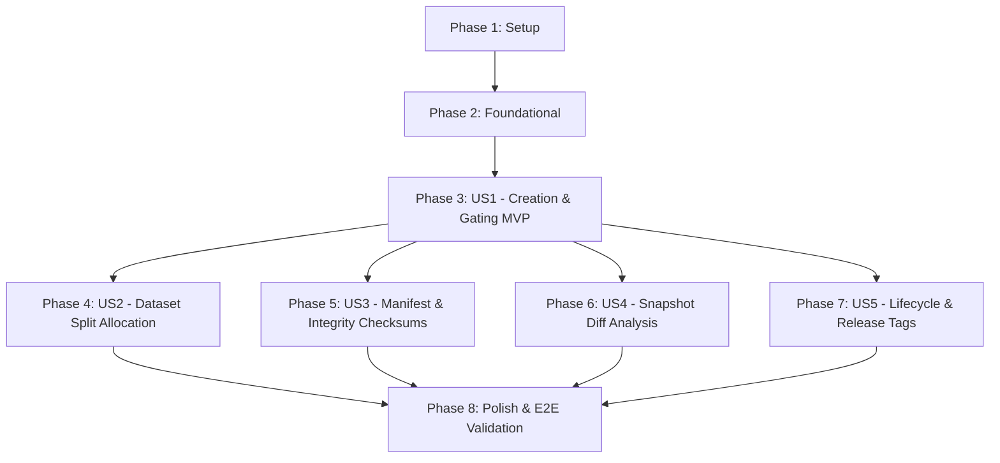

# Tasks: Snapshot Domain & Immutable Dataset Publishing

**Input**: Design documents from `specs/004-snapshot-domain/` (`spec.md`, `plan.md`, `research.md`, `data-model.md`, `contracts/domain-interfaces.md`, `contracts/api-contracts.md`, `quickstart.md`)

**Prerequisites**: plan.md (completed), spec.md (completed), data-model.md (completed), contracts/ (completed), research.md (completed)

**Tests**: Unit and integration test tasks are included to satisfy Constitution Principle "Comprehensive Coverage" and the verification gates.

**Organization**: Tasks are grouped by shared infrastructure, foundational layers, and user stories (P1 to P3) to enable independent, testable increments conforming to Clean Architecture and DDD principles.

## Format: `[ID] [P?] [Story] Description`

- **[P]**: Can run in parallel (different files, no dependencies)
- **[Story]**: Which user story this task belongs to (`US1` = Immutable Snapshot & Quality Gating, `US2` = Dataset Split Allocation, `US3` = Manifest & Integrity Checksum, `US4` = Diff Analysis, `US5` = Lifecycle & Release Tagging)
- Exact file paths included in every task

---

## Phase 1: Setup & Module Scaffolding

**Purpose**: Initialize directory layout and package structure for `modules/snapshot/` and API routers according to Clean Architecture guidelines.

- [x] T001 Create directory layout for `modules/snapshot/` (`domain/entities`, `domain/interfaces`, `domain/services`, `domain/exceptions`, `application/dtos`, `application/use_cases`, `infrastructure/persistence`, `infrastructure/repositories`, `infrastructure/gateways`, `infrastructure/background`) in `modules/snapshot/`
- [x] T002 [P] Create all package initialization `__init__.py` files across `modules/snapshot/` subdirectories
- [x] T003 [P] Create router directory structure in `apps/api/routers/snapshot/` with `__init__.py`
- [x] T004 [P] Create test directory structure under `tests/modules/snapshot/unit/` and `tests/modules/snapshot/integration/`

---

## Phase 2: Foundational (Domain Entities, Enums, Protocols & Database Schema)

**Purpose**: Core pure domain entities, value objects, exceptions, repository protocols, and database schema that MUST be complete before use case execution.

**⚠️ CRITICAL**: No user story use case work can proceed until foundational domain entities and persistence tables exist.

- [x] T005 [P] Implement pure domain value objects and enums (`SnapshotStatus`: "CREATING", "READY", "ARCHIVED", "FAILED"; `SelectionPolicy`: "LATEST_APPROVED", "LATEST_SUBMITTED"; `SplitStrategy`: "RANDOM", "STRATIFIED"; `SplitRatios`: train/validation/test summing to 1.0) in `modules/snapshot/domain/value_objects.py`
- [x] T006 [P] Implement domain exceptions (`SnapshotImmutableError`, `OntologyIncompatibilityError`, `SnapshotNotFoundError`, `InvalidSplitRatioError`, `ActiveDependencyConflictError`) in `modules/snapshot/domain/exceptions.py`
- [x] T007 [P] Implement pure domain entities (`SnapshotEntity`, `SnapshotItemEntity`, `SnapshotManifestEntity`, `ReleaseTagEntity` with sortable ULID `id`, non-null positive integer `created_by`, and immutability invariants) in `modules/snapshot/domain/entities.py`
- [x] T008 [P] Implement abstract repository and gateway protocols (`SnapshotRepository`, `SnapshotItemRepository`, `SnapshotManifestRepository`, `ReleaseTagRepository`, `DatasetGateway`, `AnnotationGateway`, `OntologyGateway`, `StorageGateway`) in `modules/snapshot/domain/interfaces.py`
- [x] T009 [P] Unit test pure domain entity methods (`mark_ready`, `mark_failed`, `archive`, `assert_mutable`) and `SplitRatios.validate` in `tests/modules/snapshot/unit/test_entities.py`
- [x] T010 Define SQLAlchemy 2.0 mapped models (`SnapshotModel` with `UNIQUE(project_id, version_name)`, `SnapshotItemModel` with `UNIQUE(snapshot_id, asset_id)` and keyset index `(snapshot_id, id)`, `SnapshotManifestModel`, `SnapshotTagModel` with `UNIQUE(project_id, name)`) in `modules/snapshot/infrastructure/persistence/models.py`
- [x] T011 Create Alembic database migration script creating `snapshots`, `snapshot_items`, `snapshot_manifests`, and `snapshot_tags` tables with foreign keys and indexes in `migrations/versions/`
- [x] T012 Configure Dishka dependency injection container registering repositories, gateways, and services in `modules/snapshot/di.py`

**Checkpoint**: Core domain rules, entity invariants, persistence tables, and DI wiring ready.

---

## Phase 3: User Story 1 - Create Immutable Snapshot with Quality & Ontology Gating (Priority: P1) 🎯 MVP

**Goal**: Allow Project Admins and ML Engineers to create an immutable dataset snapshot from a specific Dataset Version and published Ontology Version, selecting annotation revisions by policy (`LATEST_APPROVED` / `LATEST_SUBMITTED`), validating ontology conformance, and supporting manual cancellation.

**Independent Test**: Request snapshot creation from a dataset version with 10 assets and multiple revisions. Verify status is `CREATING`, transitions to `READY`, references approved revisions, and rejects direct modification attempts (SC-001).

### Tests for User Story 1
- [x] T013 [P] [US1] Unit test `CreateSnapshotUseCase` and `CancelSnapshotUseCase` mock orchestrations in `tests/modules/snapshot/unit/test_create_snapshot.py`
- [x] T014 [P] [US1] Unit test `SnapshotWorker` execution loop, cancellation hook, and 60-minute timeout handling in `tests/modules/snapshot/unit/test_snapshot_worker.py`
- [x] T015 [P] [US1] Integration test for snapshot creation lifecycle (`CREATING` -> `READY`, and `cancelled_by_user`) in `tests/modules/snapshot/integration/test_snapshot_lifecycle.py`

### Implementation for User Story 1
- [x] T016 [P] [US1] Implement Pydantic v2 schemas (`SnapshotCreateRequest`, `SnapshotResponse`, `SnapshotListResponse`) in `modules/snapshot/application/dtos/snapshot_dtos.py`
- [x] T017 [US1] Implement `DatasetGateway` fetching asset references and checking referential locks in `modules/snapshot/infrastructure/gateways/dataset_gateway.py`
- [x] T018 [US1] Implement `AnnotationGateway` resolving latest approved or submitted revisions in `modules/snapshot/infrastructure/gateways/annotation_gateway.py`
- [x] T019 [US1] Implement `OntologyGateway` validating revision schema conformance against published ontology in `modules/snapshot/infrastructure/gateways/ontology_gateway.py`
- [x] T020 [US1] Implement `SnapshotRepository` with CRUD and project version uniqueness check in `modules/snapshot/infrastructure/repositories/snapshot_repository.py`
- [x] T021 [US1] Implement `SnapshotItemRepository` supporting bulk insertion (`bulk_create`) in `modules/snapshot/infrastructure/repositories/snapshot_item_repository.py`
- [x] T022 [US1] Implement `SnapshotWorker` background execution process with 60-minute hard timeout (`asyncio.timeout(3600)`) and cancellation detection in `modules/snapshot/infrastructure/background/snapshot_worker.py`
- [x] T023 [US1] Implement `CreateSnapshotUseCase` validating inputs, creating `CREATING` record, and dispatching worker in `modules/snapshot/application/use_cases/create_snapshot.py`
- [x] T024 [US1] Implement `CancelSnapshotUseCase` setting cancellation flag and transitioning to `FAILED` with `cancelled_by_user` in `modules/snapshot/application/use_cases/cancel_snapshot.py`
- [x] T025 [US1] Implement `GetSnapshotDetailUseCase` and `ListSnapshotsUseCase` in `modules/snapshot/application/use_cases/get_snapshot_detail.py` and `modules/snapshot/application/use_cases/list_snapshots.py`
- [x] T026 [US1] Implement FastAPI routes for snapshot creation (`POST /snapshots` returning 202 Accepted), cancellation (`POST /snapshots/{id}/cancel`), detail (`GET /snapshots/{id}`), and listing (`GET /snapshots`) in `apps/api/routers/snapshot/snapshots.py`

**Checkpoint**: User Story 1 MVP fully functional — snapshots can be initiated asynchronously, queried, cancelled, and finalized into immutable state.

---

## Phase 4: User Story 2 - Configurable Dataset Split Allocation (Priority: P1)

**Goal**: Partition snapshot items into deterministic `train`, `validation`, and `test` splits using reproducible random splitting (with seed) or multilabel iterative stratification (preserving class distribution within ≤ 2% tolerance).

**Independent Test**: Partition a dataset specifying 70/15/15 ratio with fixed seed. Running split generation repeatedly yields identical allocations (SC-003) and class deviation ≤ 2% (SC-004).

### Tests for User Story 2
- [x] T027 [P] [US2] Unit test pure domain `StratificationService` for multilabel iterative stratification balance and unannotated asset uniform distribution in `tests/modules/snapshot/unit/test_stratification_service.py`
- [x] T028 [P] [US2] Unit test random split allocation reproducibility with seed in `tests/modules/snapshot/unit/test_random_splitter.py`

### Implementation for User Story 2
- [x] T029 [US2] Implement pure-Python `StratificationService` (Sechidis multilabel iterative stratification with seeded tie-breaking and uniform unannotated distribution) in `modules/snapshot/domain/services/stratification_service.py`
- [x] T030 [US2] Integrate `StratificationService` into `SnapshotWorker` split assignment step in `modules/snapshot/infrastructure/background/snapshot_worker.py`
- [x] T031 [US2] Add split validation error handling (`invalid_split_ratios` when sum != 1.0 or values < 0) in `modules/snapshot/application/dtos/snapshot_dtos.py`

**Checkpoint**: Deterministic random and stratified dataset splitting operational and verified within 2% deviation threshold.

---

## Phase 5: User Story 3 - Snapshot Manifest & Audit Metadata Generation (Priority: P1)

**Goal**: Compute deterministic SHA-256 item checksums and sorted aggregate digest, generate canonical JSON manifest, persist to MinIO/S3 object storage, and expose keyset/offset streaming API for downstream consumers.

**Independent Test**: Fetch manifest of completed snapshot; verify item count, annotation count, per-split percentages, and aggregate checksum match actual snapshot items (SC-005). Stream items via keyset pagination in < 50ms p95.

### Tests for User Story 3
- [x] T032 [P] [US3] Unit test pure domain `ChecksumService` for deterministic canonical JSON SHA-256 hashing and sorted aggregate digest in `tests/modules/snapshot/unit/test_checksum_service.py`
- [x] T033 [P] [US3] Integration test for `StorageGateway` MinIO upload and pre-signed download URI in `tests/modules/snapshot/integration/test_storage_gateway.py`
- [x] T034 [P] [US3] Integration test for Keyset pagination (`id > cursor`, limit 1000) streaming 10,000 items in `tests/modules/snapshot/integration/test_keyset_pagination.py`

### Implementation for User Story 3
- [x] T035 [P] [US3] Implement pure domain `ChecksumService` (item canonical JSON SHA-256 and lexicographically sorted aggregate digest) in `modules/snapshot/domain/services/checksum_service.py`
- [x] T036 [US3] Implement `StorageGateway` using platform S3/MinIO client for manifest persistence in `modules/snapshot/infrastructure/gateways/storage_gateway.py`
- [x] T037 [US3] Implement `SnapshotManifestRepository` in `modules/snapshot/infrastructure/repositories/snapshot_manifest_repository.py`
- [x] T038 [US3] Implement Keyset pagination query (`WHERE snapshot_id = :id AND id > :cursor ORDER BY id ASC LIMIT :limit`) and offset fallback in `SnapshotItemRepository` in `modules/snapshot/infrastructure/repositories/snapshot_item_repository.py`
- [x] T039 [US3] Implement `GetSnapshotManifestUseCase` in `modules/snapshot/application/use_cases/get_snapshot_manifest.py`
- [x] T040 [US3] Implement `ListSnapshotItemsUseCase` supporting keyset cursor and split filtering in `modules/snapshot/application/use_cases/list_snapshot_items.py`
- [x] T041 [US3] Implement FastAPI endpoints for manifest retrieval (`GET /snapshots/{id}/manifest`) and paginated item query (`GET /snapshots/{id}/items`) in `apps/api/routers/snapshot/items.py`

**Checkpoint**: Canonical manifest JSON persisted to S3, aggregate checksum verified, and items queryable via high-throughput Keyset pagination.

---

## Phase 6: User Story 4 - Snapshot Comparison & Diff Analysis (Priority: P2)

**Goal**: Compare two snapshots within the same project using a two-tier architecture: immediate high-level KPI summary delta (added, removed, modified, split movements, class deltas) and on-demand paginated item-level diff endpoint.

**Independent Test**: Compare Snapshot v1 and v2 where 5 assets were added, 2 modified, and 1 moved split. Diff summary returns in < 3 seconds (SC-006) and item-level endpoint returns exact asset IDs.

### Tests for User Story 4
- [x] T042 [P] [US4] Unit test `SnapshotDiffService` calculation logic with mock snapshots in `tests/modules/snapshot/unit/test_diff_service.py`
- [x] T043 [P] [US4] Integration test for cross-project comparison rejection and two-tier diff queries in `tests/modules/snapshot/integration/test_diff_service.py`

### Implementation for User Story 4
- [x] T044 [P] [US4] Implement Pydantic DTO schemas for diff summary and paginated item changes (`SnapshotDiffSummaryResponse`, `SnapshotDiffItemsResponse`) in `modules/snapshot/application/dtos/snapshot_dtos.py`
- [x] T045 [US4] Implement `SnapshotDiffService` executing optimized PostgreSQL set queries for additions, removals, modifications, and split shifts in `modules/snapshot/infrastructure/repositories/snapshot_diff_service.py`
- [x] T046 [US4] Implement `DiffSnapshotsUseCase` (validating same project, orchestrating summary and item queries) in `modules/snapshot/application/use_cases/diff_snapshots.py`
- [x] T047 [US4] Implement FastAPI routes for diff summary (`GET /snapshots/diff`) and granular item changes (`GET /snapshots/diff/items`) in `apps/api/routers/snapshot/diff.py`

**Checkpoint**: Two-tier Snapshot Diff comparison operational and returning deltas in under 3 seconds.

---

## Phase 7: User Story 5 - Snapshot Lifecycle & Safe Deletion Guardrails (Priority: P3)

**Goal**: Support mutable release alias tagging (`production`, `staging`), soft-deletion archiving (`ARCHIVED`), downstream active job protection, and Project Owner-only hard purge.

**Independent Test**: Assign and reassign release tag `production` across snapshots; attempt deletion of snapshot with active downstream dependency (blocked); soft-delete with no dependencies (becomes `ARCHIVED`); hard-purge as Project Owner (records and S3 files removed).

### Tests for User Story 5
- [x] T048 [P] [US5] Unit test `ManageReleaseTagsUseCase` tag assignment, reassignment, and deletion in `tests/modules/snapshot/unit/test_manage_release_tags.py`
- [x] T049 [P] [US5] Integration test for soft-delete (`ARCHIVED`), dependency conflict (`409`), and Owner-only purge permissions in `tests/modules/snapshot/integration/test_lifecycle_deletion.py`

### Implementation for User Story 5
- [x] T050 [P] [US5] Implement Pydantic DTO schemas for release tags (`ReleaseTagCreateRequest`, `ReleaseTagResponse`) in `modules/snapshot/application/dtos/snapshot_dtos.py`
- [x] T051 [US5] Implement `ReleaseTagRepository` (`upsert`, `get_by_project_and_name`, `list_by_project`, `delete`) in `modules/snapshot/infrastructure/repositories/release_tag_repository.py`
- [x] T052 [US5] Implement `ManageReleaseTagsUseCase` (assign, list, remove tags with `UNIQUE(project_id, name)` constraint) in `modules/snapshot/application/use_cases/manage_release_tags.py`
- [x] T053 [US5] Implement `ArchiveSnapshotUseCase` (verifying zero active downstream export/training jobs, transitioning status to `ARCHIVED`) in `modules/snapshot/application/use_cases/archive_snapshot.py`
- [x] T054 [US5] Implement `PurgeSnapshotUseCase` (restricting execution strictly to Project Owner, deleting DB records and purging S3 manifest) in `modules/snapshot/application/use_cases/purge_snapshot.py`
- [x] T055 [US5] Implement FastAPI routes for tagging (`POST /snapshots/{id}/tags`, `GET /tags`, `DELETE /tags/{name}`) in `apps/api/routers/snapshot/tags.py`
- [x] T056 [US5] Implement FastAPI routes for soft-delete (`DELETE /snapshots/{id}`) and hard purge (`DELETE /snapshots/{id}/purge`) in `apps/api/routers/snapshot/snapshots.py`

**Checkpoint**: Release tags, soft-delete archiving, and Owner-only hard purge guardrails fully implemented.

---

## Phase 8: Polish, Cross-Cutting Concerns & Integration Hardening

**Purpose**: Upstream referential guard integration, router mounting, documentation, and end-to-end quickstart validation.

- [x] T057 Mount unified snapshot router in `apps/api/routers/snapshot/__init__.py` and register in `apps/api/main.py`
- [x] T058 Implement referential protection guard in `modules/dataset/` and `modules/annotation/` preventing hard deletion of assets or revisions pinned by READY/ARCHIVED snapshots
- [x] T059 [P] Execute full test suite `uv run pytest tests/modules/snapshot/ -v` and verify 0 failures
- [x] T060 Execute end-to-end scenarios in `specs/004-snapshot-domain/quickstart.md` confirming SC-001 through SC-006 pass
- [x] T061 [P] Run code formatting and linting via `ruff check` and `ruff format` on touched snapshot module files

---

## Dependencies & Execution Order

### Phase Dependencies
- **Phase 1 (Setup)**: No dependencies — start immediately.
- **Phase 2 (Foundational)**: Depends on Phase 1 — **BLOCKS all user stories**.
- **Phase 3 (User Story 1 - MVP)**: Depends on Phase 2. Core capability of the domain.
- **Phase 4 (User Story 2 - Split)**: Depends on Phase 2 and integrates with Phase 3 worker.
- **Phase 5 (User Story 3 - Manifest & Checksum)**: Depends on Phase 2 and integrates with Phase 3 worker.
- **Phase 6 (User Story 4 - Diff)**: Depends on Phase 2 and Phase 3 (compares created snapshots).
- **Phase 7 (User Story 5 - Lifecycle & Tags)**: Depends on Phase 2 and Phase 3 (tags and manages finalized snapshots).
- **Phase 8 (Polish)**: Depends on all user stories being complete.



---

## Parallel Opportunities

### Within Phase 2 (Foundational)
```bash
# Launch domain modeling in parallel:
Task: T005 [P] Value objects in modules/snapshot/domain/value_objects.py
Task: T006 [P] Exceptions in modules/snapshot/domain/exceptions.py
Task: T007 [P] Entities in modules/snapshot/domain/entities.py
Task: T008 [P] Protocols in modules/snapshot/domain/interfaces.py
```

### Within Phase 3 (User Story 1 MVP)
```bash
# Launch tests and DTOs in parallel:
Task: T013 [P] [US1] Unit test CreateSnapshotUseCase in tests/modules/snapshot/unit/test_create_snapshot.py
Task: T014 [P] [US1] Unit test SnapshotWorker in tests/modules/snapshot/unit/test_snapshot_worker.py
Task: T016 [P] [US1] Pydantic DTOs in modules/snapshot/application/dtos/snapshot_dtos.py
```

### Across Later User Stories (Post-MVP)
- **Developer A**: User Story 4 (Snapshot Diff Service in `modules/snapshot/infrastructure/repositories/snapshot_diff_service.py`)
- **Developer B**: User Story 5 (Release Tagging in `modules/snapshot/infrastructure/repositories/release_tag_repository.py`)

---

## Implementation Strategy

### MVP First (Phases 1, 2, 3)
1. Complete Setup and Foundational layers (T001–T012).
2. Complete User Story 1 (T013–T026): Asynchronous snapshot creation with quality gating.
3. **Validate MVP**: Create a snapshot with default split, verify `READY` status, check immutability.

### Incremental Delivery
1. **Increment 1**: Add Multilabel Iterative Stratification (Phase 4, T027–T031) → Verify 2% distribution deviation (SC-004).
2. **Increment 2**: Add Manifest & Keyset Streaming (Phase 5, T032–T041) → Verify SHA-256 digests and O(1) item streaming.
3. **Increment 3**: Add Snapshot Diff Service (Phase 6, T042–T047) → Verify two-tier comparison in < 3s (SC-006).
4. **Increment 4**: Add Release Tagging & Owner Purge Guardrails (Phase 7, T048–T056) → Verify mutable aliases and soft/hard deletion.
5. **Increment 5**: Complete Polish & E2E Validation (Phase 8, T057–T061).
